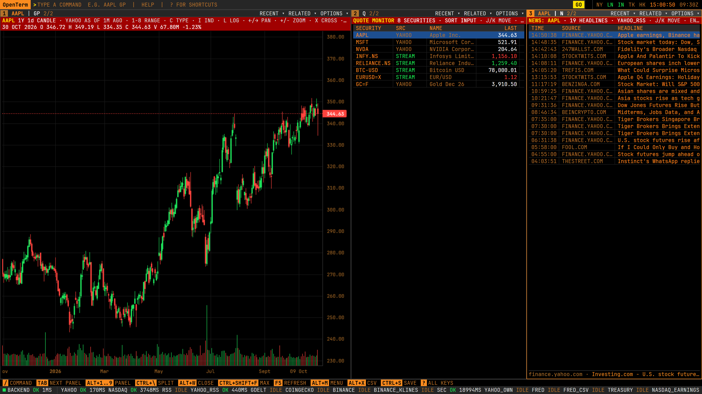
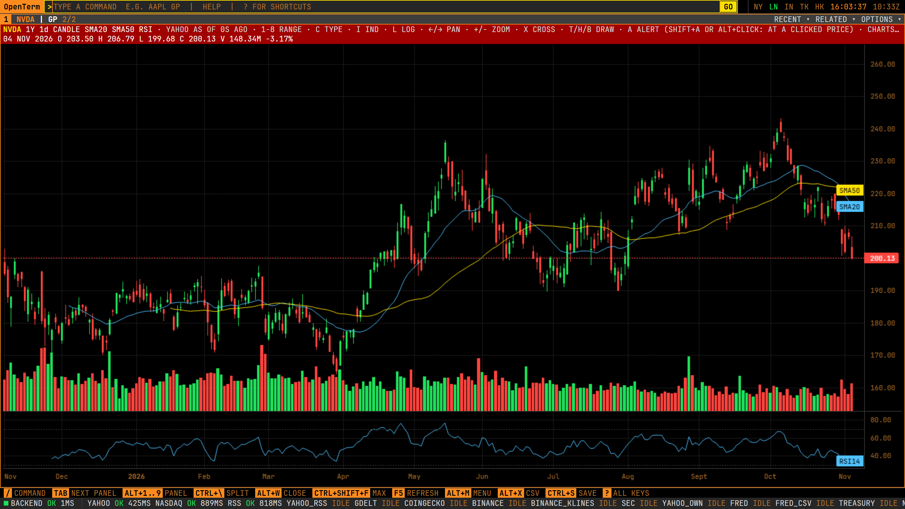
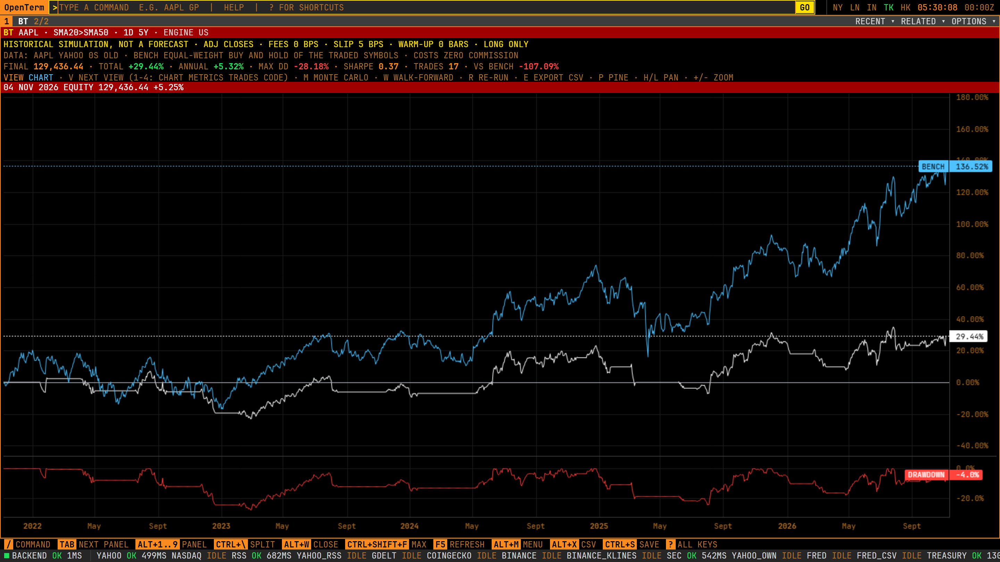
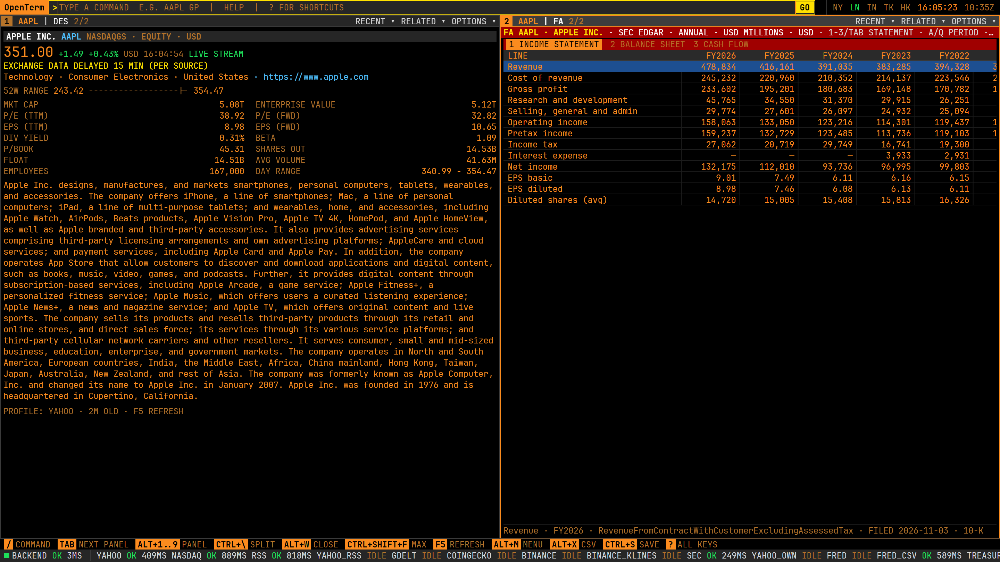
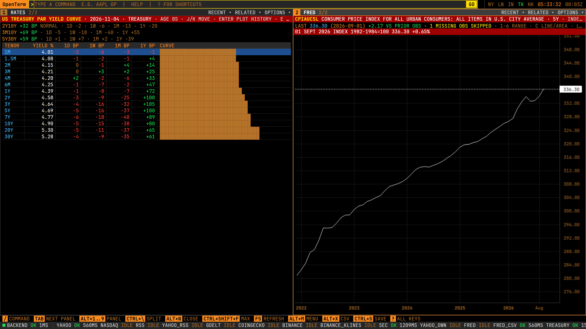
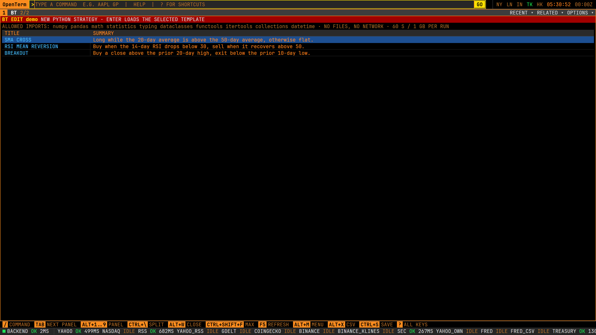
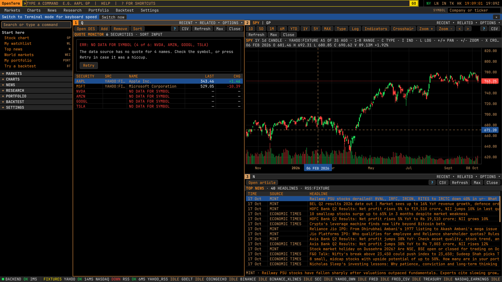
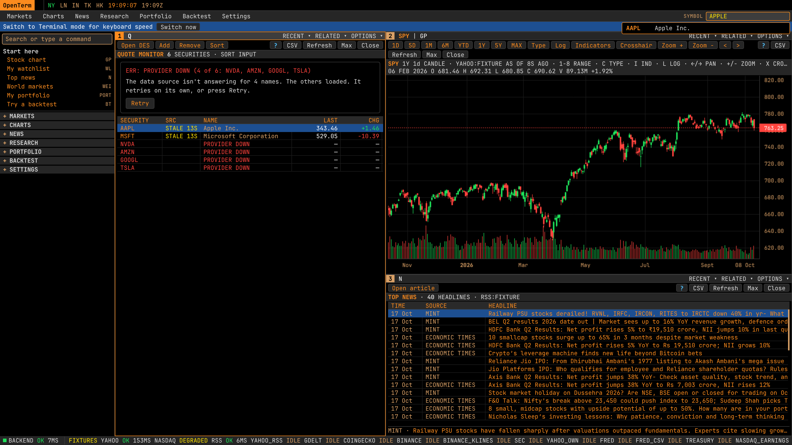
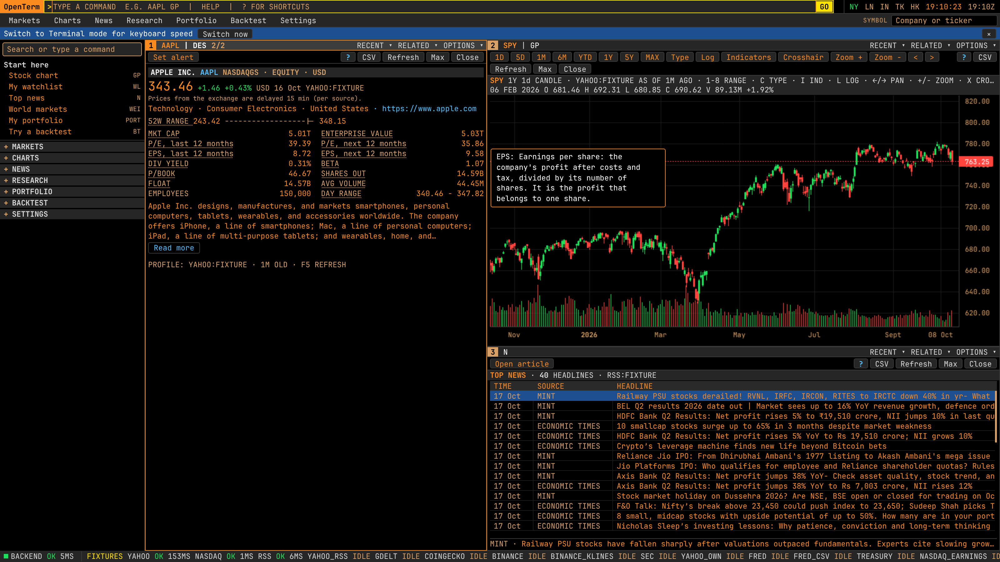
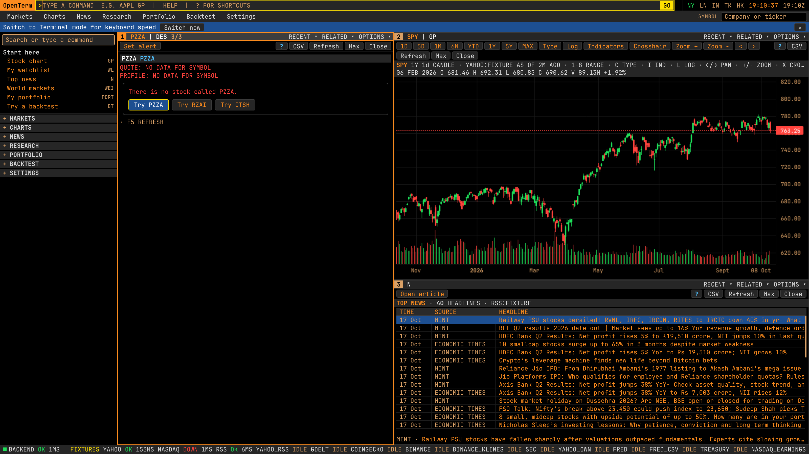

# OpenTerm

**A very fast, keyboard-first market terminal that runs on your own computer, with free data and no account.**
You type a short command (`AAPL GP` for a chart, `Q` for live quotes, `FA` for financial statements) and tiled panels
appear instantly. Dark, dense, amber on black, in the style of a professional trading terminal.



> **Not investment advice.** OpenTerm shows market data from free public sources. It can be delayed, incomplete or wrong,
> and the sources can change or block access at any time. Backtests are historical simulations, not forecasts.
> OpenTerm does **not** place orders or connect to a broker. It is not affiliated with any commercial terminal vendor.

## Why it feels different: it is built to be fast

Speed is the main feature, not an afterthought. Every number below is a **budget that the project's own benchmark
(`node scripts/bench.mjs`) must meet** before a change is accepted. Latest recorded run (Windows PC, 2026-10-19: 37 of 37 pass):

| What you do | Result | Budget |
|---|---|---|
| Open the app to a usable command line | **about 80 ms** | 1500 ms |
| Press a key, see it on screen | **about 14 ms** (less than one 60 Hz frame) | 16.7 ms |
| Run a cached command, see the panel painted | **about 16 ms** | 100 ms |
| Live price tick arrives, pixel changes | **about 36 ms** with 4,000 ticks per second flowing into 9 panels | 50 ms |
| Scroll a 10,000-row table | **16.8 ms per frame** (smooth 60 fps) | 20 ms |
| Pan a chart of 50,000 candles | **16.7 ms per frame** | 20 ms |
| Backend answering a cached quote | **about 1 ms** | 20 ms |
| Backtest 10 years of daily bars | **about 0.2 s** | 0.3 s |
| Download size of the app (JS and CSS, compressed) | **about 84 KB** | 400 KB |
| Memory used by the page with 9 panels and 200 live symbols | **about 5 MB** | 500 MB |

How it stays fast: no animations, shadows or web fonts; tables and charts are drawn on a canvas instead of thousands of page
elements; live ticks are batched into one repaint per frame; the server keeps one upstream connection per symbol however many
panels watch it; heavy maths runs in separate worker processes so it never blocks typing. Details and history:
[docs/PERFORMANCE.md](docs/PERFORMANCE.md).

## What you can do with it

| | |
|---|---|
| **Charts and quotes** | Candlestick, line and area charts with many indicators, drawing tools, event markers, comparison panes; live quote boards for stocks, indices, FX, commodities and crypto |
| **Companies** | Profile, financial statements and filings straight from SEC EDGAR, insider trades, holders, estimates, peers, valuation (DCF) |
| **Screening** | Screen the whole US stock universe, compare peers, correlation matrices, sector heat map, seasonality |
| **Macro** | FRED economic series, Treasury yield curve, earnings and economic calendars, world statistics, central banks |
| **Derivatives and fixed income** | Options chains and pricing, implied volatility, futures, bond maths, credit |
| **Crypto** | Order book depth, funding rates, basis, stablecoin supply, DeFi yields, prediction-market odds |
| **Portfolio** | Track positions with live profit and loss, price alerts, CSV import and export |
| **Backtesting** | Test a rule like `SMA20>SMA50` on years of data with realistic fees, Monte Carlo and walk-forward checks; or write a Python strategy in `BT EDIT` (code editor with starter templates and errors shown on the offending line) |
| **Risk and quant** | Value at Risk, portfolio optimisation, factor and attribution analysis |
| **AI (optional)** | Ask questions answered with the app's own data, every answer showing which tools it used. Needs an OpenRouter key |
| **Alerts and briefs** | Alerts can reach you by email, Telegram or a webhook (`DLVR`, all off by default), plus a scheduled daily brief (`BRIEF`) |
| **MCP server** | Let Claude Desktop, Claude Code or another MCP client read OpenTerm's data (read-only, never orders). See [docs/MCP.md](docs/MCP.md) |

| Charts with indicators | Backtesting |
|---|---|
|  |  |

| Fundamentals from SEC filings | Rates and economic calendar |
|---|---|
|  |  |

| Strategy editor (`BT EDIT`) |
|---|
|  |

All of it works with **zero API keys**. A key (all free to sign up for, except the optional AI one) unlocks more. The full list
of functions is in [docs/FUNCTIONS.md](docs/FUNCTIONS.md).

## Install (step by step, about 10 minutes)

You do not need to know how to code. You need three free tools, then three commands.
The finished install is about **330 MB** on disk.

### 1. Install the tools (one time)

| Tool | What it is for |
|---|---|
| **uv** | Installs and runs the Python part of OpenTerm. It also downloads the right Python version by itself, so you do **not** need to install Python. |
| **Node.js 20 or newer** | Builds the screen you see in the browser (once). |
| **Git** (optional) | Downloads the code. You can skip it and download a ZIP instead. |

**Windows** (open the Start menu, type `PowerShell`, press Enter, then paste):

```powershell
winget install --id astral-sh.uv -e
winget install --id OpenJS.NodeJS.LTS -e
winget install --id Git.Git -e
```

Close PowerShell and open it again so it can find the new tools. Check they work:

```powershell
uv --version
node --version
```

Both should print a version number (Node must say v20 or higher).

**macOS** (Terminal): `brew install uv node git` (needs [Homebrew](https://brew.sh)).
**Linux:** install Node 20+ with your package manager, then `curl -LsSf https://astral.sh/uv/install.sh | sh`.
macOS and Linux scripts are included but have not been tested by the author; please report anything that breaks.

### 2. Get OpenTerm

With Git:

```powershell
git clone https://github.com/ImTheRealARB/OpenTerm.git
cd OpenTerm
```

Without Git: on the [repository page](https://github.com/ImTheRealARB/OpenTerm) click the green **Code** button, then
**Download ZIP**, unzip it, and open PowerShell inside the unzipped folder (in File Explorer, click the address bar, type
`powershell`, press Enter). On Windows, right-click the ZIP **before** unzipping, choose Properties and tick **Unblock**.

### 3. Set up and start

```powershell
.\scripts\setup.ps1
.\scripts\start.ps1
```

The first command downloads what OpenTerm needs (about a minute). The second builds the screen, starts the app and opens
your browser at **http://localhost:8000**. Leave the PowerShell window open while you use it; press `Ctrl+C` there to stop.

macOS / Linux: `./scripts/setup`, then `./scripts/start`.

**Got a red error saying "running scripts is disabled"?** That is Windows being cautious. Run this once, then try again:

```powershell
Set-ExecutionPolicy -Scope CurrentUser RemoteSigned
```

### 4. Start it from anywhere (optional)

```powershell
.\scripts\install-launcher.ps1
```

After this, typing `openterm` in any PowerShell or Command Prompt window starts the app. It only adds one small file to a
folder that is already on your PATH; `.\scripts\install-launcher.ps1 -Remove` undoes it. macOS/Linux: `./scripts/install-launcher`.
`openterm` always runs the copy in the folder you installed it from, so new features arrive only after `git pull` there (see Updating).

### Updating

```powershell
git pull
.\scripts\setup.ps1
```

The next `start.ps1` (or `openterm`) rebuilds the screen automatically if the code changed, and reinstalls the
frontend packages first if `git pull` changed them; the backend's packages are synced on every start. So after a pull,
`openterm` alone is usually enough; `setup.ps1` is still the safe full refresh.

### Prefer Docker?

```sh
docker compose up --build      # then open http://localhost:8000
```

The Docker files are written but have not been built by the author yet.

## Your first five minutes

### Two ways to use it: GUI mode and Terminal mode

The first time you open OpenTerm it starts in **GUI mode**, made for people who have never used a market terminal.
You start on a ready-made screen (a few large US stocks, a chart and top news). The sidebar's **Start here** group has
plain-word buttons (Stock chart, My watchlist, Top news, World markets, My portfolio, Try a backtest); every other
function sits in a collapsed category, with its short code shown small and grey as a learning aid.
Type a company name ("apple", "tesla") in the symbol box and pick a suggestion. Hover over, or tab to, a term such as
EPS or P/E for a one-line plain-English explanation. Errors say what to do next (Retry, "Try AAPL", "Open API keys"),
and empty lists offer the next step ("Add a stock"). Click `?` on any panel (or press `Alt+H`) for its purpose, buttons and keys.

| | |
|---|---|
|  |  |
|  |  |

**Terminal mode** is the same app with only the command line, built for keyboard speed. Switch with the
`TERMINAL | GUI` control at the bottom right, `Alt+G`, or `SETTINGS MODE TERMINAL`. Your choice is saved. Everything
below works in both modes. Terminal mode also takes a market sector word after the ticker (`SPX INDEX GP`,
`EURUSD CURNCY`), digits + Enter to open a row in a list, F2/F3/F4/F8/F9 as sector keys, and `FUNC` lists every function.


### Try these commands

Press `/` to focus the command line at the top, then try these, pressing `Enter` after each:

| Type | You get |
|---|---|
| `AAPL GP` | Apple price chart. Keys on the chart: `1`-`8` change the range, `c` chart type, `i` indicators |
| `AAPL DES` | Company description, valuation, 52 week range |
| `Q AAPL MSFT NVDA INFY.NS BTC-USD` | Live quote board |
| `WEI` | World equity indices, live |
| `N` | Market news |
| `AAPL FA` | Income statement, balance sheet, cash flow from SEC filings |
| `RATES` | US Treasury yield curve |
| `BT AAPL SMA20>SMA50 1D 5Y` | Backtest a moving-average crossover over 5 years |
| `HELP` | Every function. `HELP GP` explains one |
| `?` | Every keyboard shortcut |

Use **Shift+Enter** instead of Enter to open the result in a **new panel** next to the others. `Tab` jumps between panels.
`LAYOUT SAVE MYDESK` saves your arrangement; `LAYOUT MYDESK` brings it back. [docs/COMMANDS.md](docs/COMMANDS.md) has
many more commands to try.

If a panel needs a key you have not set, it says `KEY REQUIRED: set X in APIKEYS` instead of failing. Open the `APIKEYS`
panel to paste keys; they are kept in your computer's secure store, never in the code.

### Two settings worth knowing

- **SEC filings (`FA`, `FIL`, `OWN`)**: the SEC asks every program to say who is calling. Open the `.env` file that `setup`
  created in the OpenTerm folder and set `SEC_USER_AGENT="Your Name you@example.com"`, then restart.
- **Different port**: if something else already uses port 8000, set `OPENTERM_PORT=8001` before starting.

### If something goes wrong

| Problem | Try this |
|---|---|
| `uv` or `node` is "not recognized" | Close and reopen PowerShell after installing. Still missing: run the `winget` lines again |
| "Port 8000 is in use" | Close the other OpenTerm window, or set `OPENTERM_PORT=8001` |
| A panel shows `STALE`, `ERR` or `PROVIDER DOWN` | A free data source is down or rate limiting you. This is shown on purpose instead of fake numbers. Check the `SOURCES` panel, wait, press `F5` |
| Screen looks old after `git pull` | `.\scripts\start.ps1 -Rebuild` |
| Want a demo with no internet | Set `OPENTERM_FIXTURES=1` before starting (replays recorded data, clearly labelled) |

## How the command line works

```
[N:] <SECURITY> [MARKET] <FUNCTION> [ARGS]     AAPL GP 1Y D  |  RELIANCE IN DES  |  2: MSFT DES
[N:] <FUNCTION> [ARGS]                         HELP GP  |  N  |  FRED GDP
```

- A **security** is a ticker (`AAPL`, `INFY.NS`, `BTC-USD`, `^GSPC`). A **function** is a short code for a screen (`GP` chart,
  `DES` description). Aliases like `SPX`, `NIFTY`, `EURUSD`, `BTCUSD` work.
- `Enter` runs in the focused panel, `Shift+Enter` in a new one, `2:` targets panel 2.
- The security sticks to the panel: after `AAPL DES`, typing `GP` charts AAPL.
- `Tab` accepts a suggestion; `Up` and `Down` move through suggestions or history. Typing a name searches live (`relian` finds `RELIANCE.NS`).
- Markets: `US`, `IN`/`NS` (.NS), `BO` (.BO), `LN`, `JP`, `HK`, `GR`, `CN`, `AU`.
- Inside a chart or table, letters are keys for that panel; press `/` or `Ctrl+K` to type a command there.
- Everything works from the keyboard; the mouse is optional.

Key shortcuts: `Alt+1..9` focus a panel, `Ctrl+\` split, `Alt+W` close, `Ctrl+Shift+F` maximise, `Ctrl+S` save the layout,
`Alt+X` export the table to CSV. All are listed by `SHORTCUTS` and defined in
[`frontend/src/keys/keybindings.json`](frontend/src/keys/keybindings.json). `SETTINGS` has themes (`AMBER`, `GREEN`, `WHITE`,
`LIGHT`), vim mode and key rebinding.

## Honest about the data

OpenTerm runs on free public sources (Yahoo Finance, Nasdaq, SEC EDGAR, FRED, Treasury, BLS, Binance, CoinGecko and others).
These are unofficial or free-tier endpoints meant for personal use, and they change. So:

- Every value carries its **source and age**. When a source fails you see `STALE`, `ERR` or `PROVIDER DOWN`, never invented numbers.
- Test data (recorded fixtures, synthetic symbols) is always **labelled on screen**.
- AI answers say `AI · model · time`, list the data they used, and say `UNGROUNDED` when they used none.
- Read [docs/DATA_LIMITS.md](docs/DATA_LIMITS.md) before relying on anything. Please respect each source's terms of use.

Not built: placing orders or broker connections, alerts while no OpenTerm tab is open (alerts are checked in the browser), and a few paid-only data
sets (`TRAN`, `SEG`, `UNLK`). See [docs/ROADMAP_PHASES_11-19.md](docs/ROADMAP_PHASES_11-19.md).

## For developers

```powershell
.\scripts\setup.ps1 -Dev          # adds test and lint tools and Chromium for the end-to-end tests (about 1.5 GB more)
.\scripts\dev.ps1                 # backend on :8000 and Vite on http://localhost:5173 with hot reload
node scripts/gates.mjs            # every check: ruff, tsc, pytest, vitest, Playwright
node scripts/bench.mjs            # the performance budgets
python scripts/new_function.py FOO --title "..."     # scaffold a new function
```

```
backend/   Python 3.12, FastAPI, async; /api/* and one multiplexed /ws WebSocket
frontend/  React + TypeScript + Vite; canvas grids and charts; plain CSS
scripts/   setup, start, dev, bench, gates, recorders
desktop/   Tauri desktop shell (scaffold, never built)
docs/      reference, specs, performance, review notes
```

Environment variables (all optional; `.env` is read automatically):

| Variable | Effect |
|---|---|
| `SEC_USER_AGENT` | `"Your Name you@example.com"`, needed for `FA`, `FIL`, `OWN` |
| `FRED_API_KEY` | Free key: FRED titles and full `MACRO` search (without it a keyless feed is used) |
| `OPENTERM_PORT` | Port to serve on (default 8000) |
| `OPENTERM_FIXTURES=1` | Replay recorded responses, no network (demos) |
| `OPENTERM_SYNTHETIC=1` | Synthetic symbols and ticks for load testing |
| `OPENTERM_DB_PATH` | Where layouts, watchlists and portfolios are stored (SQLite) |

Keys for other providers are entered in the `APIKEYS` panel, never on the command line.
HTTP API: `/api/quote`, `/api/history`, `/api/profile`, `/api/search`, `/api/sources` and more, plus a WebSocket at `/ws`.

### Docs

- **[User reference: every function, key and feature](docs/FUNCTIONS.md)** (generated: `python scripts/gen_functions_doc.py`)
- [Commands to try](docs/COMMANDS.md) · [Data limits](docs/DATA_LIMITS.md) · [Performance](docs/PERFORMANCE.md)
- [Adding a function](docs/ADDING_A_FUNCTION.md) · [Adding a provider](docs/ADDING_A_PROVIDER.md)
- [Release notes](docs/RELEASE_NOTES.md) · [Changelog](CHANGELOG.md) · [Desktop build](docs/DESKTOP.md)
- [Project status and handoff](HANDOFF.md) · [Third-party code and licences](THIRD_PARTY.md)

## Credits and licence

MIT, see [LICENSE](LICENSE). Charts use [TradingView Lightweight Charts™](https://www.tradingview.com/lightweight-charts/)
(Apache-2.0, copyright © TradingView, Inc.). The backtest engine and quant library include code ported from
[Vibe-Trading](https://github.com/HKUDS/Vibe-Trading) (MIT); every ported file is listed in [THIRD_PARTY.md](THIRD_PARTY.md).
