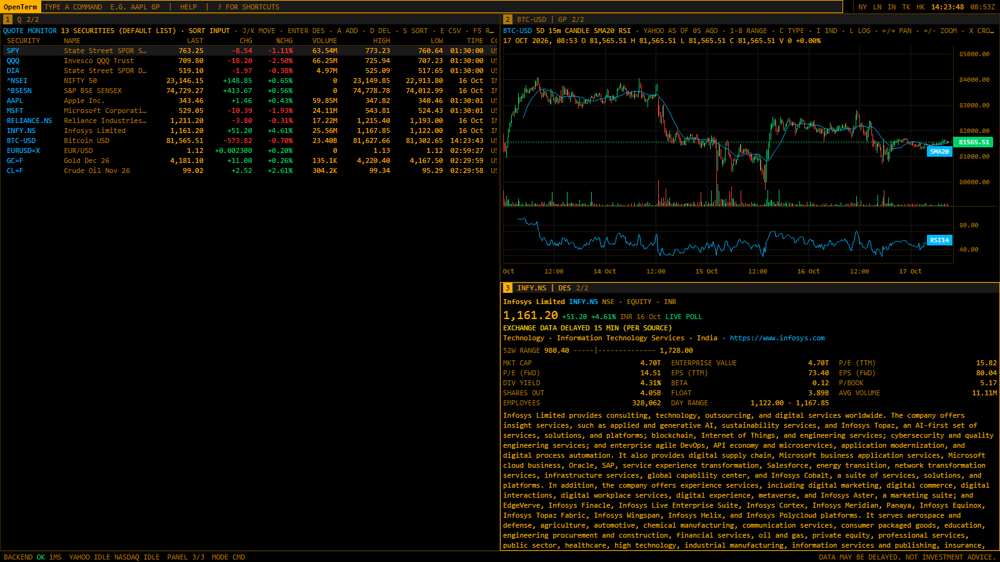

# OpenTerm

A keyboard-first, open-source market terminal for one power user: a command line on top, tiled panels,
mnemonic function codes, and free data sources. Dense, dark, amber on black. Speed over looks.

> Status: **Phase 3 of 10**. Shell, command system and perf instrumentation (1); data core with
> Yahoo + Nasdaq, cache, rate limits and fallback (2); live streaming, `GP`, `DES`, `Q`, `QR` (3).
> Data may be delayed. Not investment advice.



## Quick start (zero API keys)

Requirements: [uv](https://docs.astral.sh/uv/) and Node 20+.

Windows (PowerShell):

```powershell
.\scripts\setup.ps1
.\scripts\dev.ps1
```

macOS/Linux:

```sh
./scripts/setup
./scripts/dev
```

Open http://localhost:5173. The backend runs on :8000.

## Command line

Focus it with `/`, `` ` ``, `Ctrl+K`, or just start typing.

```
[N:] <SECURITY> [MARKET] <FUNCTION> [ARGS]     AAPL GP 1Y D · RELIANCE IN DES · 2: MSFT DES
[N:] <FUNCTION> [ARGS]                         HELP GP · N · FRED GDP
```

- `Enter` runs in the focused panel. `Shift+Enter` runs in a new panel. `2:` targets panel 2.
- The security is sticky per panel: `GP` on a panel showing AAPL charts AAPL.
- `Tab` accepts a suggestion. `↑/↓` move through suggestions or history.
- Markets: `US`, `IN`/`NS` (.NS), `BO` (.BO), `LN`, `JP`, `HK`, `GR`, `CN`, `AU`. Explicit suffixes (`RELIANCE.NS`, `BTC-USD`) pass through.

## Functions

`HELP` lists every function and the phase it ships in. Ready now:

| Code | What it does |
|---|---|
| `GP` | Price chart. `AAPL GP 5Y W LOG`, `RELIANCE.NS GP 5D 15MIN VWAP`, `AAPL GP VS SPY` (rebased %). Keys: `1-8` range, `c` type, `i` indicators (SMA20/50, EMA20, BB, RSI, MACD, VWAP), `l` log, `←/→` pan, `+/-` zoom, `x` keyboard crosshair with OHLCV readout. |
| `DES` | Description: profile, valuation, 52-week range, live price. |
| `Q` | Live quote monitor. `Q AAPL MSFT INFY.NS BTC-USD`; no args = default world list. Keys: `j/k`, `Enter` (DES), `a` add, `d` delete, `s` sort, `e` CSV, `F5`. |
| `QR` | Quote recap for one security, live. |
| `HELP`, `SHORTCUTS`, `PERF`, `SOURCES`, `LOG` | Help, key list, performance HUD/panel (`PERF GRID 10000`, `PERF CHART 50000` load tests), provider health, backend log. |

In grids and charts, letters are panel keys; press `/` (or Ctrl+K) to type a command there.

Typing a ticker in the command line searches symbols live (`relian` → `RELIANCE.NS`). Highlighting a
result prefetches its quote and 1Y bars. Aliases: `SPX`, `NDX`, `NIFTY`, `SENSEX`, `EURUSD`, `BTCUSD` ...

## Data

Works with **zero API keys** (Yahoo Finance + Nasdaq.com public endpoints). Every value carries its
`source` and `as_of`; when a provider fails you see `STALE` or `PROVIDER DOWN`, never invented numbers.
Read [docs/DATA_LIMITS.md](docs/DATA_LIMITS.md) before relying on any of it: these are unofficial
endpoints for personal use, and they change.

API: `/api/quote?symbols=`, `/api/history?symbol=&range=&interval=`, `/api/profile?symbol=`, `/api/search?q=`,
`/api/sources`, `/api/log`, `/api/layouts[/{name}]` (GET/PUT/DELETE), `/api/cmdhistory` (GET/POST), and one WebSocket `/ws` (`["sub", [symbols]]` → `["T", [[symbol, price, chg, pct,
volume, high, low, time_ms, src], ...]]`). However many panels watch a symbol, the server holds one
upstream subscription for it.

Charts use [TradingView Lightweight Charts™](https://www.tradingview.com/lightweight-charts/) (Apache-2.0).
Copyright © TradingView, Inc. The logo is disabled; attribution is shown in the `GP` status line and here.

## Shortcuts

Defined in [`frontend/src/keys/keybindings.json`](frontend/src/keys/keybindings.json) and listed by `SHORTCUTS` or `?`.
Panels: `Alt+1..9` focus · `Tab` cycle · `Ctrl+\` / `Ctrl+-` split · `Alt+W` close · `Ctrl+Shift+Arrows` resize ·
`Ctrl+Shift+F` maximize · `Ctrl+[` / `Ctrl+]` history · `Ctrl+Shift+P` PERF HUD.
Layouts: `LAYOUT SAVE|LOAD|DEL name` (alias `MONITOR`), `LAYOUT` lists them · `Ctrl+S` save · `Ctrl+O` open.
Named layouts and command history are stored in SQLite (`data/openterm.db`).

## Performance

Budgets are enforced in CI by `node scripts/bench.mjs`. See [docs/PERFORMANCE.md](docs/PERFORMANCE.md).

## Docs

- [Adding a function](docs/ADDING_A_FUNCTION.md)
- [Adding a provider](docs/ADDING_A_PROVIDER.md)
- [Data limits](docs/DATA_LIMITS.md)
- [Handoff / project status](HANDOFF.md)

## Layout

```
backend/   FastAPI, orjson, async; /api/*, one multiplexed /ws
frontend/  React + TS + Vite; canvas for live grids/charts; plain CSS
scripts/   setup, dev, bench
docs/
```

## License

MIT. OpenTerm is not affiliated with any commercial terminal vendor.
