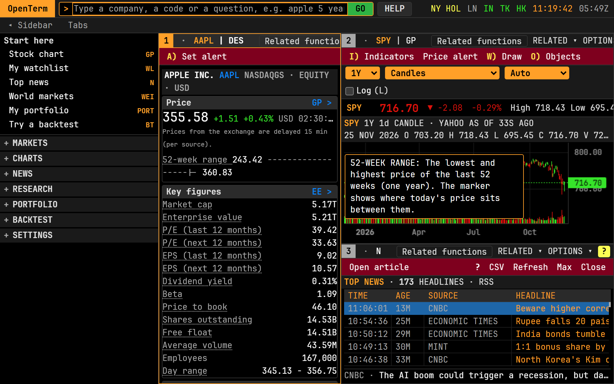
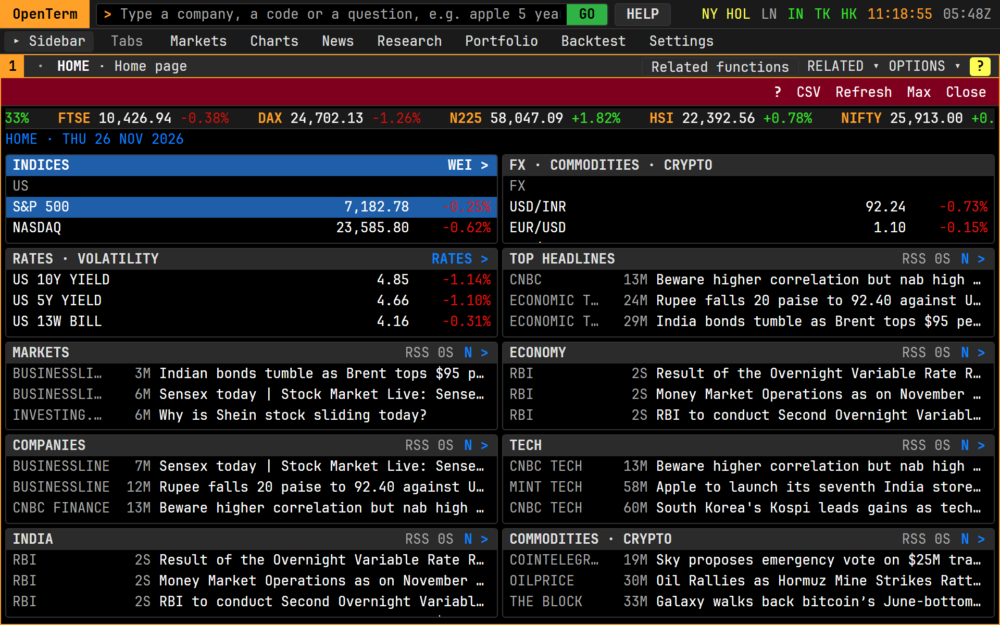
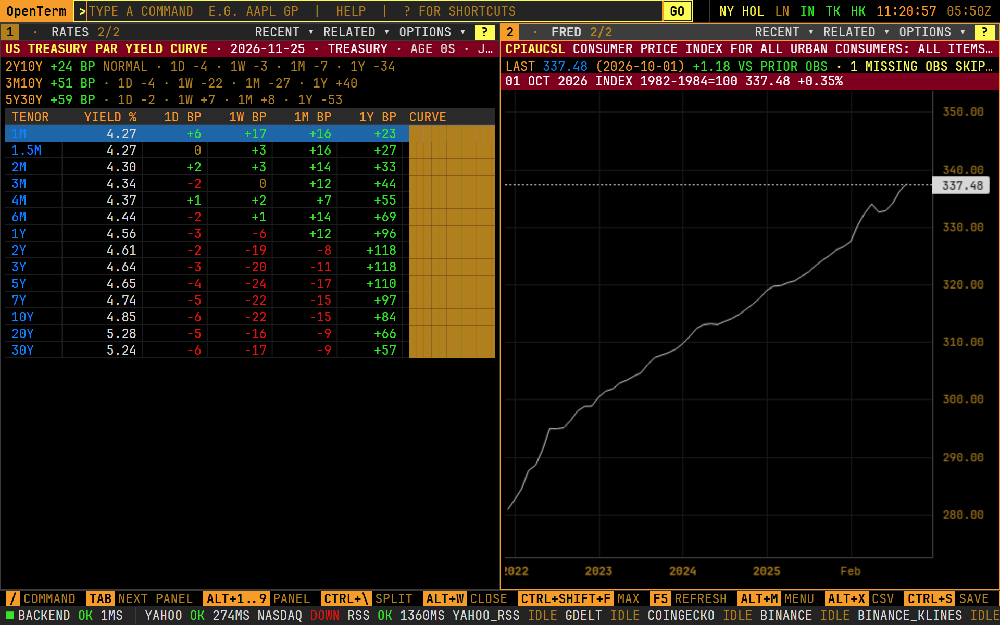
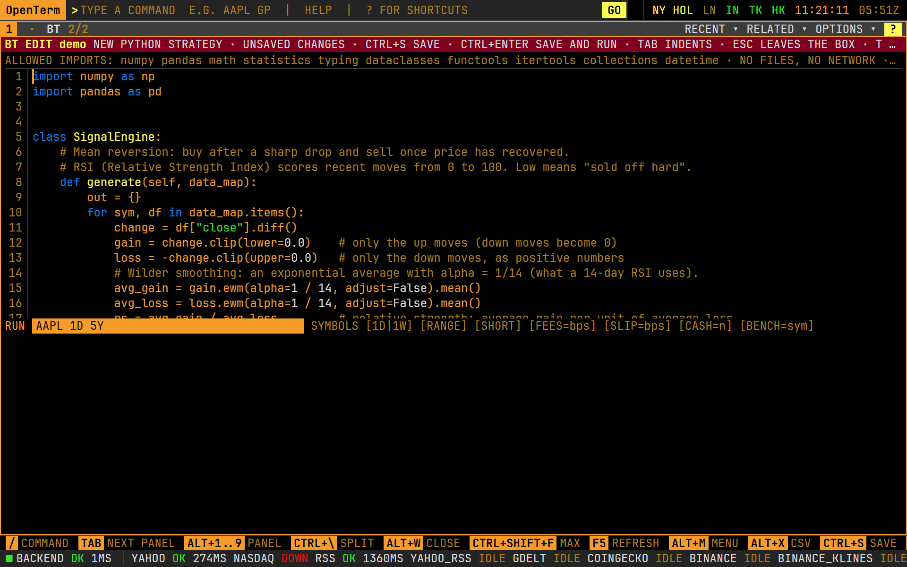

<div align="center">


# OpenTerm

**A free, fast, open-source market terminal that runs on your own computer.**

Quotes, charts, company filings, macro data, screens and backtests, one command away.<br>
No account, no subscription, no API key needed to start.

[](LICENSE)
[](docs/PERFORMANCE.md)
[](#api-keys-optional)
[](backend/pyproject.toml)
[](frontend/package.json)

[Quick start](#quick-start) ·
[Tour](#a-five-minute-tour) ·
[Features](#features) ·
[Screenshots](#screenshots) ·
[Performance](#performance) ·
[Docs](#documentation)

<br>


</div>

## Why OpenTerm

A market terminal is a program that puts live prices, charts, company accounts, news and economic data behind one
command line. The professional ones are fast and complete, but expensive, and they assume you already know the codes.
OpenTerm is an open-source terminal of the same kind, built on three ideas:

- **Free and local.** It runs on free public data, on your own machine. Your layouts, watchlists and keys never leave it.
- **Easy on day one, fast on day one hundred.** **GUI mode** has menus, plain-English buttons and a hover glossary.
  **Terminal mode** is the same app with only the command line, for speed.
- **Honest about its data.** Every value shows its source and age. When a source fails, the panel says so instead of
  showing an invented number.

A *function* is a short code for one screen: `GP` is the price graph, `DES` the company description, `FA` the financial
statements. Type a company and a function, `AAPL GP`, and the screen opens. You do not have to learn any codes first:
`apple stock price past 5 years` works too, and OpenTerm shows the code it understood (`AAPL GP 5Y`), so you pick them
up as you go.

> [!NOTE]
> **Not investment advice.** The data comes from free public sources, which can be delayed, incomplete or wrong, and
> can change or block access at any time. Backtests are historical simulations, not forecasts. OpenTerm never places
> real orders, and it is not affiliated with any commercial terminal vendor.

## Quick start

You need two free tools: **[uv](https://docs.astral.sh/uv/)**, which installs and runs the Python half (it downloads
the right Python by itself), and **[Node.js](https://nodejs.org/) 20 or newer**, which builds the screen. **Git** is
optional. The finished install takes about 330 MB.

<details open>
<summary><b>Windows</b> (PowerShell)</summary>

```powershell
winget install --id astral-sh.uv -e
winget install --id OpenJS.NodeJS.LTS -e
winget install --id Git.Git -e
```

Close PowerShell, open it again, then run:

```powershell
git clone https://github.com/ImTheRealARB/OpenTerm.git
cd OpenTerm
.\scripts\setup.ps1
.\scripts\start.ps1
```

If Windows says "running scripts is disabled", run `Set-ExecutionPolicy -Scope CurrentUser RemoteSigned` once and try again.

</details>

<details>
<summary><b>macOS</b> (Terminal, with <a href="https://brew.sh">Homebrew</a>)</summary>

```sh
brew install uv node git
git clone https://github.com/ImTheRealARB/OpenTerm.git
cd OpenTerm
./scripts/setup
./scripts/start
```

</details>

<details>
<summary><b>Linux</b></summary>

Install `git`, `curl` and Node.js 20 or newer with your package manager. The Node package on Debian and Ubuntu is often
too old, so use [nvm](https://github.com/nvm-sh/nvm) (`nvm install --lts`). Then run:

```sh
curl -LsSf https://astral.sh/uv/install.sh | sh
git clone https://github.com/ImTheRealARB/OpenTerm.git
cd OpenTerm
./scripts/setup
./scripts/start
```

On a machine with no desktop, start with `./scripts/start --no-browser` and open the address from another computer.

</details>

Your browser opens at **http://localhost:8000**. Keep the terminal window open while you use OpenTerm, and press
`Ctrl+C` there to stop it.

- **No Git?** Click **Code**, then **Download ZIP** on this page, unzip it (on Windows, tick **Unblock** in the ZIP's
  Properties first) and run the same `setup` and `start` lines inside the folder.
- **Updating:** run `git pull`, then start as usual. The start script rebuilds the screen and refreshes packages when the
  code has changed.
- **Shortcut:** `.\scripts\install-launcher.ps1` (or `./scripts/install-launcher`) adds an `openterm` command that starts
  the app from any terminal.

> [!IMPORTANT]
> OpenTerm is developed and tested on Windows. The macOS and Linux scripts are short and plain but have not been run on
> those systems yet. If anything breaks, please [open an issue](https://github.com/ImTheRealARB/OpenTerm/issues) with
> the error text.

## A five-minute tour

The first launch opens **GUI mode** with a short welcome card. New tabs open on the **home page** (`HOME`): market
numbers for the US, India, Europe, Asia, FX, commodities, crypto and rates, headlines by section, and a scrolling ticker
tape. `TAPE ADD SYM` edits the tape, and `SETTINGS STARTUP LAYOUT` makes new tabs restore your saved workspace instead.

<table>
<tr>
<td width="50%"><br><sub><b>Sidebar</b>: every screen grouped by what it does</sub></td>
<td width="50%"><br><sub><b>Glossary</b>: hover a term for a plain explanation</sub></td>
</tr>
</table>

- **Type what you want** in the command line at the top, in plain English or as a code, and press `Enter`.
- **Or browse.** The sidebar lists every screen by what it does, with its code next to it. The `Sidebar` button swaps
  it for the same list as menus across the top, which gives the panels the full width.
- **Every panel explains itself.** Its title bar says what it is, and its toolbar shows each action with its key.
- **Hover a term** such as P/E or EPS for a one-line explanation, and click `?` on any panel for its help.
- **Errors suggest the next step**, such as Retry or "Try AAPL", instead of leaving a blank panel.

Things to type:

| Type | You get |
|---|---|
| `apple stock price past 5 years` | Apple's price chart over five years (`AAPL GP 5Y`) |
| `apple vs microsoft since 2021` | Both on one chart |
| `tesla news` | Tesla headlines (`TSLA N`) |
| `N TECH`, `N INDIA`, `N COMMODITY GOLD` | News from 45 feeds, filtered by section, country, sector or commodity |
| `nifty 50`, `reliance share price`, `bitcoin 1 year`, `gold price` | Indian indices and NSE shares, crypto, commodities |
| `amazon balance sheet` | The balance sheet from SEC filings (`AMZN FA BS`) |
| `tech stocks under 50 dollars` | A stock screen (`EQS`) |
| `AAPL DES` | Apple's description, valuation and 52-week range |
| `WEI` | World stock indices, live |
| `BT AAPL SMA20>SMA50 1D 5Y` | A backtest of a moving-average crossover |
| `HELP` | Every function. `HELP GP` explains one |

Plain English is read by a small set of rules on your computer, not by an AI, so it is instant and free. When a name
fits several companies it asks "did you mean", and exact codes such as `AAPL GP` always run as typed.

**Terminal mode** is the same app with only the command line: switch with `Alt+G` or from the **Settings** menu.
`Shift+Enter` opens a result in a new panel, `Tab` moves between panels, and `LAYOUT SAVE MYDESK` saves your screen.
[docs/COMMANDS.md](docs/COMMANDS.md) has many more commands to try.

## Features

| Area | What you get |
|---|---|
| **Charts and quotes** | Sixteen chart types, 109 indicators (`IND`) including your own formulas, 30 drawing tools, volume profiles and anchored VWAP, bar replay with a practice book, formulas as securities (`AAPL/MSFT`), event markers, and alerts on prices, indicators and drawn lines. Live boards for stocks, indices, currencies, commodities and crypto. |
| **Companies** | Profile, financial statements and filings from SEC EDGAR (with full-text search), insider trades, holders, estimates, peers, a DCF valuation, quality scores and long-run fundamentals. |
| **Screening and queries** | The whole US stock universe, an ETF screener, indicator scans over index, NIFTY and watchlist universes, a query language (`QRY`) that also works from Python and Excel, peer comparison, correlation, heat maps and seasonality. |
| **Macro** | FRED series, yield curves and forward rates, money-market rates, GDP nowcasts and forecasts, FOMC statement changes, rate-move odds, Treasury auctions, credit spreads, energy and crop reports, earnings and economic calendars, world statistics and a central-bank research library (`RES`). |
| **India** | NSE and BSE shares, indices, futures and options, MCX and currency futures. Free Yahoo data by default; with a paid [Zerodha Kite Connect](https://kite.trade/) app, real-time quotes, minute bars back to 2015 and option chains. Read-only. |
| **Derivatives and crypto** | Option chains and pricing, probabilities, expected moves and P/L curves, implied volatility, futures and their expiry calendars, order books, crypto trade tape and footprint, funding rates, DeFi yields. |
| **World and trade** | A world map with ships, ports, chokepoints and earthquakes (`MAP`), shipping and port activity, trade flows, US and UK official data. |
| **Portfolio and backtesting** | Positions with live profit and loss and CSV import. Backtests with fees, slippage, Monte Carlo and walk-forward checks, written as a sentence or in Python (`BT EDIT`); parameter search with overfitting checks (`BT OPT`) and paper forward tests (`BT LIVE`). |
| **Risk, quant and AI** | Value at Risk, portfolio optimisation, factor analysis, local JupyterLab notebooks (`NB`). Optional AI answers that show which data they used, suggested questions in every table (`?`), filing and earnings-release summaries whose quotes are checked word for word, and an MCP server for Claude and other assistants (read-only). |

Every function is listed in [docs/FUNCTIONS.md](docs/FUNCTIONS.md).

## Screenshots

<table>
<tr>
<td width="50%"><br><sub><b>HOME</b>: markets by region, headlines and a ticker tape</sub></td>
<td width="50%"><br><sub><b>GP</b>: candles with moving averages and RSI</sub></td>
</tr>
<tr>
<td><br><sub><b>DES + HDS</b>: company profile and top holders</sub></td>
<td><br><sub><b>RATES + FRED</b>: rates board and US CPI</sub></td>
</tr>
<tr>
<td><br><sub><b>BT</b>: a backtest with fees and slippage</sub></td>
<td><br><sub><b>BT EDIT</b>: strategies written in Python</sub></td>
</tr>
</table>

## Performance

Speed is treated as a feature with a budget. Every number below must pass the project's own benchmark
(`node scripts/bench.mjs`) before a change is accepted. The table is from a Windows PC on 5 November 2026; the latest
run, on Linux on 10 November 2026, had all 39 budgets within limits ([full record](docs/PERFORMANCE.md)).

| What you do | Result | Budget |
|---|---|---|
| Open the app to a usable command line | about 95 ms | 1,500 ms |
| Press a key, see it on screen | about 15 ms | 16.7 ms |
| Run a cached command, see the panel | about 18 ms | 100 ms |
| A live price arrives, the pixel changes (4,000 ticks a second, 9 panels) | about 37 ms | 50 ms |
| Scroll a 10,000-row table or pan a 50,000-candle chart | 16.7 ms a frame | 20 ms |
| Backtest 10 years of daily bars | about 0.28 s | 0.3 s |
| App download size (compressed) | about 120 KB | 400 KB |

Most of the speed comes from restraint: no animations, shadows or web fonts; tables and charts drawn on a canvas
instead of thousands of page elements; live prices batched into one repaint per frame; and heavy maths in separate
processes, so it never blocks typing.

## Data and honesty

OpenTerm runs on free public sources (Yahoo Finance, Nasdaq, SEC EDGAR, FRED, the US Treasury, Binance and others),
which are meant for personal use and change without notice. So:

- Every value carries its **source and age**.
- When a source fails, the panel says `STALE`, `ERR` or `PROVIDER DOWN` rather than showing an invented number.
- When one source fails, the next one in a fixed order answers, and the panel names it.
- Test data is always labelled on screen.

Read [docs/DATA_LIMITS.md](docs/DATA_LIMITS.md) before relying on anything, and please respect each source's terms.

## API keys (optional)

Everything works with **zero keys**; a key only unlocks more. Paste keys into the `APIKEYS` panel, which also links to
each sign-up page. Keys are kept in your computer's secure store, are never typed on the command line, and are never
sent anywhere except to their own provider.

| Key | What it adds |
|---|---|
| Finnhub, FMP, Alpaca | Estimates, recommendations, IPOs, real-time US quotes and news |
| FRED, EIA, BLS, BEA, Census | Series titles and search, energy, US jobs, prices, GDP and trade |
| Kite Connect (paid) | The first source for Indian markets; the login lasts one trading day, then Yahoo takes over |
| UN Comtrade, Companies House, Etherscan, AISstream, Marketaux | Trade flows, UK companies, Ethereum, live ships, news sentiment (all free) |
| An AI provider (OpenRouter, Anthropic, OpenAI, OpenCode Go and others) | The optional AI panels, billed by that provider (OpenCode Go: your flat subscription) |
| Telegram, email or a webhook | Alerts and a daily brief sent to you (off by default) |

For `FA`, `FIL` and `OWN`, the SEC asks every program to say who is calling: set
`SEC_USER_AGENT="Your Name you@example.com"` in the `.env` file that setup created, then restart.

## Troubleshooting

| Problem | Try this |
|---|---|
| `uv` or `node` is "not recognised" | Close and reopen the terminal after installing |
| "Port 8000 is in use" | Close the other OpenTerm window, or start with `OPENTERM_PORT=8001` |
| A panel says `STALE`, `ERR` or `PROVIDER DOWN` | A free source is down or rate-limiting you. `SOURCES` shows which one; wait, then press Refresh |
| The screen looks old after `git pull` | `.\scripts\start.ps1 -Rebuild` (Windows) or `./scripts/start --rebuild` |
| You want a demo with no internet | Start with `OPENTERM_FIXTURES=1`: recorded data, clearly labelled |
| `npm ci` prints `EUSAGE` and a long help text | Run it inside `frontend/`, where `package-lock.json` lives. The esbuild "install scripts" warning is harmless |
| Your own script gets 400 `CONTENT-TYPE MUST BE application/json` | Send that header on POST, PUT and DELETE: see [docs/API.md](docs/API.md) |

## Development

```sh
./scripts/setup --dev       # adds test tools and Chromium (about 1.5 GB more); Windows: .\scripts\setup.ps1 -Dev
./scripts/dev               # backend on :8000 and Vite with hot reload on http://localhost:5173
node scripts/gates.mjs      # every check: ruff, tsc, ESLint, pytest, vitest, Playwright
node scripts/bench.mjs      # the performance budgets
python scripts/new_function.py FOO --title "..."    # scaffold a new function
```

Tests never touch the network: they replay recorded responses from `backend/tests/fixtures/`.

```text
backend/     Python 3.12 + FastAPI: data providers, cache, streaming, backtests, quant jobs, AI layer
frontend/    React 19 + TypeScript + Vite: command line, panels, canvas grids and charts
scripts/     setup, start, dev server, benchmark, test gates, fixture recorders
docs/        user and developer documentation (index below)
sdk/python/  openterm-sdk, a read-only Python client
notebooks/   example Jupyter notebooks for the SDK and query language
examples/    a minimal extension to copy
desktop/     Tauri desktop shell (experimental)
deploy/      Caddy + Docker Compose for hosting your own copy remotely
```

## Documentation

| Using OpenTerm | Data | Extending and integrating |
|---|---|---|
| [Every function and key](docs/FUNCTIONS.md) | [Data sources](docs/DATA_SOURCES.md) | [REST API](docs/API.md) |
| [Commands to try](docs/COMMANDS.md) | [Data limits](docs/DATA_LIMITS.md) | [Python SDK](docs/SDK.md) |
| [Trade journal (`JRNL`)](docs/JOURNAL.md) | [Performance record](docs/PERFORMANCE.md) | [Excel bridge](docs/EXCEL.md) |
| [AI web access](docs/AI_WEB.md) | [Third-party code and licences](THIRD_PARTY.md) | [MCP server for AI assistants](docs/MCP.md) |
| [Hosting your own copy](docs/HOSTING.md) | [Vibe-Trading porting notes](docs/porting/) | [Extensions](docs/EXTENSIONS.md) |
| [Desktop app and Docker](docs/DESKTOP.md) | | [Adding a function](docs/ADDING_A_FUNCTION.md) · [Adding a provider](docs/ADDING_A_PROVIDER.md) |
| [Release notes](docs/RELEASE_NOTES.md) · [Changelog](CHANGELOG.md) | | [Design rules](DESIGN.md) |

## Credits and licence

OpenTerm is released under the [MIT licence](LICENSE). Charts use
[TradingView Lightweight Charts™](https://www.tradingview.com/lightweight-charts/) (Apache-2.0, copyright © TradingView,
Inc.). The backtest engine and quant library include code ported from
[Vibe-Trading](https://github.com/HKUDS/Vibe-Trading) (MIT); every ported file is listed in [THIRD_PARTY.md](THIRD_PARTY.md).
