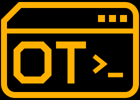

<div align="center">



# OpenTerm

**A fast, keyboard-first market terminal that runs on your own computer.**<br>
Free data. No account. Charts, quotes, filings, macro, backtests and more, one command away.

[](LICENSE)
[](backend)
[](frontend)
[](docs/PERFORMANCE.md)
[](#optional-api-keys)

[Quick start](#quick-start) ·
[What you can do](#what-you-can-do) ·
[Install](#install) ·
[First five minutes](#your-first-five-minutes) ·
[Speed](#built-to-be-fast) ·
[Docs](#docs)

<br>


<sub>GUI mode, live data: quote monitor, chart and news side by side. Amber on black, no animations, no web fonts.</sub>

</div>

> **Not investment advice.** OpenTerm shows market data from free public sources. It can be delayed, incomplete or wrong,
> and the sources can change or block access at any time. Backtests are historical simulations, not forecasts.
> OpenTerm does **not** place orders or connect to a broker. It is not affiliated with any commercial terminal vendor.

## Why OpenTerm

| | |
|---|---|
| **Free, with no sign-up** | Runs on public data sources (Yahoo Finance, SEC EDGAR, FRED, Treasury, Binance and others). Every function works with zero API keys. A free key, when you add one, unlocks more. |
| **Keyboard first** | Type `AAPL GP` for a chart, `Q` for live quotes, `FA` for financial statements. Tiled panels appear instantly. The mouse is optional. |
| **Easy to start, deep when you want it** | **GUI mode** has a menu bar, plain-English buttons and tooltips for people who have never used a market terminal. **Terminal mode** is the same app, command line only, for speed. |
| **Honest about its data** | Every number shows its source and age. A failure shows `STALE`, `ERR` or `PROVIDER DOWN`, never an invented value. Test data is always labelled on screen. |
| **Fast on purpose** | Speed is a feature with budgets that the benchmark must meet before any change is accepted. See [Built to be fast](#built-to-be-fast). |
| **Yours** | Runs locally. Your layouts, watchlists, portfolios and API keys stay on your computer. MIT licensed. |

## Quick start

You need **uv**, **Node.js 20 or newer** and, optionally, **Git** (the [install section](#install) shows how to get them on each system).
Then three steps, about ten minutes the first time:

<details open>
<summary><b>Windows</b> (PowerShell)</summary>

```powershell
git clone https://github.com/ImTheRealARB/OpenTerm.git
cd OpenTerm
.\scripts\setup.ps1
.\scripts\start.ps1
```

</details>

<details>
<summary><b>macOS</b> (Terminal)</summary>

```sh
git clone https://github.com/ImTheRealARB/OpenTerm.git
cd OpenTerm
./scripts/setup
./scripts/start
```

</details>

<details>
<summary><b>Linux</b> (any terminal)</summary>

```sh
git clone https://github.com/ImTheRealARB/OpenTerm.git
cd OpenTerm
./scripts/setup
./scripts/start
```

</details>

Your browser opens at **http://localhost:8000**. Leave the terminal window open while you use OpenTerm and press `Ctrl+C` there to stop it.

## What you can do

| | |
|---|---|
| **Charts and quotes** | Candlestick, hollow candle, bar, line, area, baseline and Heikin Ashi charts, drawing tools, event markers and comparison panes. An indicator library (`IND`, 109 indicators, your own formulas like `EMA(close,12) - EMA(close,26)`, saved presets). Price alerts set straight from the chart. Live quote boards for stocks, indices, FX, commodities and crypto. |
| **Companies** | Profile, financial statements and filings straight from SEC EDGAR, insider trades, holders, estimates, peers and valuation (DCF). |
| **Screening** | Screen the whole US stock universe, compare peers, correlation matrices, a sector heat map and seasonality. |
| **Macro** | FRED economic series, the Treasury yield curve, earnings and economic calendars, world statistics and central banks. |
| **Derivatives and fixed income** | Options chains and pricing, implied volatility, futures, bond maths and credit. |
| **Crypto** | Order book depth, funding rates, basis, stablecoin supply, DeFi yields and prediction-market odds. |
| **India** | NSE and BSE shares, indices, futures and options (NFO, BFO), MCX commodities and currency futures (CDS). Works on free Yahoo data; with a paid [Zerodha Kite Connect](https://kite.trade/) app it becomes the first source: real-time quotes, minute bars back to 2015, open interest, and option chains (`OMON NIFTY.NFO`, `CT USDINR.CDS`). Read-only. |
| **Trade, shipping and official data** | Ship traffic through sea chokepoints (`SHIP`), port activity (`PORTS`), live ship positions (`AIS`), trade flows between countries by product (`TRADE`), US jobs, prices, GDP and retail sales (`USMAC`), UK company register (`UKCO`), Ethereum addresses (`ADDR`), and a search across OECD, Eurostat, BIS, IMF and ECB series (`DBSRCH`). |
| **Portfolio** | Track positions with live profit and loss, price alerts, CSV import and export. |
| **Backtesting** | Test a rule like `SMA20>SMA50` on years of data with realistic fees, Monte Carlo and walk-forward checks. Build the rule as a sentence in GUI mode, or write a Python strategy in `BT EDIT`. |
| **Risk and quant** | Value at Risk, portfolio optimisation, factor and attribution analysis. |
| **AI (optional)** | Ask questions answered with the app's own data, every answer showing which tools it used. Needs a key for an AI provider. |
| **Alerts and briefs** | Alerts reach you by email, Telegram or a webhook (all off by default), plus a scheduled daily brief. |
| **MCP server** | Let Claude Desktop, Claude Code or another MCP client read OpenTerm's data. Read-only, never orders. See [docs/MCP.md](docs/MCP.md). |

The full list of functions is in [docs/FUNCTIONS.md](docs/FUNCTIONS.md).

### A look around

**Charts with indicators.** `NVDA GP 1Y SMA20 SMA50 RSI`: a candlestick chart with two moving averages and an RSI pane.


**Backtesting.** `BT AAPL SMA20>SMA50 1D 5Y`: equity curve against a buy-and-hold benchmark, with drawdown. Every backtest says `HISTORICAL SIMULATION, NOT A FORECAST` and lists its fees, slippage and data source.


**Company fundamentals from SEC filings.** `AAPL DES` and `AAPL FA` side by side: profile and valuation on the left, the income statement from SEC EDGAR on the right.


**Rates and macro.** `RATES` for the US Treasury yield curve, `FRED CPIAUCSL` for any FRED series. Also in the app: the economic calendar (`ECO`), central banks (`CENB`) and world statistics (`ECST`).


**Your own strategies.** `BT EDIT` opens a code editor with starter templates. Strategies run in a sandbox with no file or network access, and errors show on the offending line.


## Built to be fast

Speed is the main feature, not an afterthought. Every number below is a **budget that the project's own benchmark
(`node scripts/bench.mjs`) must meet** before a change is accepted. Latest recorded run (Windows PC, 2026-11-05: 37 of 37 pass):

| What you do | Result | Budget |
|---|---|---|
| Open the app to a usable command line | **about 110 ms** | 1500 ms |
| Press a key, see it on screen | **about 15 ms** (less than one 60 Hz frame) | 16.7 ms |
| Run a cached command, see the panel painted | **about 18 ms** | 100 ms |
| Live price tick arrives, pixel changes | **about 37 ms** with 4,000 ticks per second flowing into 9 panels | 50 ms |
| Scroll a 10,000-row table | **16.7 ms per frame** (smooth 60 fps) | 20 ms |
| Pan a chart of 50,000 candles | **16.7 ms per frame** | 20 ms |
| Backend answering a cached quote | **about 1 ms** | 20 ms |
| Backtest 10 years of daily bars | **about 0.2 s** | 0.3 s |
| Download size of the app (JS and CSS, compressed) | **about 120 KB** | 400 KB |
| Memory used by the page with 9 panels and 200 live symbols | **about 8 MB** | 500 MB |

How it stays fast: no animations, shadows or web fonts; tables and charts are drawn on a canvas instead of thousands of page
elements; live ticks are batched into one repaint per frame; the server keeps one upstream connection per symbol however many
panels watch it; heavy maths runs in separate worker processes so it never blocks typing. Details and history:
[docs/PERFORMANCE.md](docs/PERFORMANCE.md).

## Install

You do not need to know how to code. You need two free tools (a third is optional), then two commands.
The finished install is about **330 MB** on disk. OpenTerm runs on Windows, macOS and Linux.

| Tool | What it is for |
|---|---|
| **uv** | Installs and runs the Python part of OpenTerm. It also downloads the right Python version by itself, so you do **not** need to install Python. |
| **Node.js 20 or newer** | Builds the screen you see in the browser (once, and again after updates). |
| **Git** (optional) | Downloads the code and lets you update it later. You can skip it and download a ZIP instead. |

> **A note on testing.** OpenTerm is developed and tested on Windows. The macOS and Linux scripts are short and plain, and are
> included for you, but the author has not run them on those systems yet. If anything breaks, please
> [open an issue](https://github.com/ImTheRealARB/OpenTerm/issues) with the error text.

### 1. Install the tools (one time)

<details open>
<summary><b>Windows</b></summary>

Open the Start menu, type `PowerShell`, press Enter, then paste:

```powershell
winget install --id astral-sh.uv -e
winget install --id OpenJS.NodeJS.LTS -e
winget install --id Git.Git -e
```

Close PowerShell and open it again so it can find the new tools. Check they work:

```powershell
uv --version
node --version
```

Both should print a version number (Node must say v20 or higher).

</details>

<details>
<summary><b>macOS</b></summary>

Open Terminal. If you do not have [Homebrew](https://brew.sh) yet, install it first by following the one-line instructions on its page. Then:

```sh
brew install uv node git
```

Check they work:

```sh
uv --version
node --version
```

Node must say v20 or higher. If `node --version` is older, run `brew upgrade node`.

</details>

<details>
<summary><b>Linux</b></summary>

Pick the block for your distribution. The goal is the same everywhere: `git`, `curl`, **Node.js 20 or newer**, and **uv**.

**Debian and Ubuntu.** The `nodejs` package in the standard repositories is often older than 20, so use [nvm](https://github.com/nvm-sh/nvm) (follow the install line on its page, then open a new terminal):

```sh
sudo apt update
sudo apt install -y git curl
nvm install --lts
```

**Fedora:**

```sh
sudo dnf install -y git curl nodejs npm
```

**Arch:**

```sh
sudo pacman -S --needed git curl nodejs npm
```

Then, on any distribution, install uv and open a new terminal so the command is found:

```sh
curl -LsSf https://astral.sh/uv/install.sh | sh
```

Check everything works:

```sh
uv --version
node --version
```

Node must say v20 or higher.

</details>

### 2. Get OpenTerm

With Git (the same on every system):

```sh
git clone https://github.com/ImTheRealARB/OpenTerm.git
cd OpenTerm
```

Without Git: on the [repository page](https://github.com/ImTheRealARB/OpenTerm) click the green **Code** button, then
**Download ZIP**, unzip it, and open a terminal inside the unzipped folder.

- **Windows:** in File Explorer click the address bar, type `powershell` and press Enter. Right-click the ZIP **before** unzipping, choose Properties and tick **Unblock**.
- **macOS and Linux:** use `cd` to go into the unzipped folder.

### 3. Set up and start

<details open>
<summary><b>Windows</b> (PowerShell)</summary>

```powershell
.\scripts\setup.ps1
.\scripts\start.ps1
```

**Got a red error saying "running scripts is disabled"?** That is Windows being cautious. Run this once, then try again:

```powershell
Set-ExecutionPolicy -Scope CurrentUser RemoteSigned
```

</details>

<details>
<summary><b>macOS and Linux</b></summary>

```sh
./scripts/setup
./scripts/start
```

**Got "permission denied"?** Run the script through the shell instead: `sh scripts/setup`, then `sh scripts/start`.
On a server or any computer with no desktop, start it with `./scripts/start --no-browser` and open the address from another computer.

</details>

The first command downloads what OpenTerm needs (about a minute). The second builds the screen, starts the app and opens
your browser at **http://localhost:8000**. Leave the terminal window open while you use it; press `Ctrl+C` there to stop.

### 4. Start it from anywhere (optional)

<details>
<summary><b>Windows</b></summary>

```powershell
.\scripts\install-launcher.ps1
```

After this, typing `openterm` in any PowerShell or Command Prompt window starts the app. It only adds one small file to a
folder that is already on your PATH; `.\scripts\install-launcher.ps1 -Remove` undoes it.

</details>

<details>
<summary><b>macOS and Linux</b></summary>

```sh
./scripts/install-launcher
```

This puts a small `openterm` command in `~/.local/bin`. If the script says that folder is not on your PATH, add this line to
your `~/.zshrc` (macOS) or `~/.bashrc` (Linux), then open a new terminal:

```sh
export PATH="$HOME/.local/bin:$PATH"
```

To undo it, delete `~/.local/bin/openterm`.

</details>

`openterm` always runs the copy in the folder you installed it from, so new features arrive only after you update that folder (see below).

### Updating

```sh
git pull
```

then run the setup script again (`.\scripts\setup.ps1` on Windows, `./scripts/setup` elsewhere) for a safe full refresh.
The next start (`start.ps1`, `./scripts/start` or `openterm`) rebuilds the screen automatically if the code changed, and reinstalls
the frontend packages first if `git pull` changed them; the backend's packages are synced on every start. So after a pull,
starting the app is usually enough.

### Prefer Docker?

```sh
docker compose up --build      # then open http://localhost:8000
```

The Docker files are written but have not been built by the author yet.

### If something goes wrong

| Problem | Try this |
|---|---|
| `uv` or `node` is "not recognized" or "command not found" | Close and reopen your terminal after installing. On Windows, if it is still missing, run the `winget` lines again. On Linux, make sure the uv installer's folder is on your PATH (it prints a line telling you what to add) |
| `node --version` shows a number below 20 | Install a newer Node (macOS: `brew upgrade node`; Linux: `nvm install --lts`; Windows: run the `winget` line again) |
| "Port 8000 is in use" | Close the other OpenTerm window, or set `OPENTERM_PORT=8001` before starting (PowerShell: `$env:OPENTERM_PORT = "8001"`; macOS and Linux: `OPENTERM_PORT=8001 ./scripts/start`) |
| A panel shows `STALE`, `ERR` or `PROVIDER DOWN` | A free data source is down or rate limiting you. This is shown on purpose instead of fake numbers. Check the `SOURCES` panel, wait, press `F5` |
| The screen looks old after `git pull` | Windows: `.\scripts\start.ps1 -Rebuild`. macOS and Linux: `./scripts/start --rebuild` |
| `FA`, `FIL` or `OWN` say the SEC refused the request | Set `SEC_USER_AGENT`, see [Two settings worth knowing](#two-settings-worth-knowing) |
| Want a demo with no internet | Set `OPENTERM_FIXTURES=1` before starting (replays recorded data, clearly labelled) |

## Your first five minutes

### Two ways to use it: GUI mode and Terminal mode

The first time you open OpenTerm it starts in **GUI mode**, made for people who have never used a market terminal.
You start on a ready-made screen: a quote list of a few large US stocks, a chart and top news.

- **Find things without learning codes.** The sidebar's **Start here** group has plain-word buttons (Stock chart, My watchlist, Top news, World markets, My portfolio, Try a backtest). Every other function sits in a collapsed category, with its short code shown small and grey as a learning aid.
- **Search by company name.** Type "apple" or "tesla" in the symbol box and pick a suggestion.
- **Learn the jargon as you go.** Hover over, or tab to, a term such as EPS or P/E for a one-line plain-English explanation.
- **Errors tell you what to do next.** Retry, "Try AAPL", "Open API keys". Empty lists offer the next step ("Add a stock").
- **Panels as tabs.** Open panels are browser-style tabs along the top (`+` for a new one). The **Tiles** button in the menu bar shows them side by side, and the **Sidebar** button hides the sidebar.
- **A tidy bottom.** The status bar at the bottom (data sources and backend health) is hidden in GUI mode. The **Status** button in the menu bar shows it.
- **Chart controls.** The chart toolbar has dropdowns for chart type (candles, hollow candles, bars, line, area, baseline, Heikin Ashi) and candle length (5 minutes to monthly).
- **Help on every panel.** Click `?` on any panel (or press `Alt+H`) for its purpose, buttons and keys.


**Terminal mode** is the same app with only the command line, built for keyboard speed. Switch with `Alt+G`, with
`SETTINGS MODE TERMINAL`, or from the **Settings** menu in GUI mode. In Terminal mode the `TERMINAL | GUI` switch sits at the bottom right. Your choice is saved. Everything
below works in both modes. Terminal mode also takes a market sector word after the ticker (`SPX INDEX GP`,
`EURUSD CURNCY`), digits and Enter to open a row in a list, F2/F3/F4/F8/F9 as sector keys, and `FUNC` lists every function.

### Try these commands

Press `/` to focus the command line at the top, then try these, pressing `Enter` after each:

| Type | You get |
|---|---|
| `AAPL GP` | Apple price chart. Keys on the chart: `1`-`8` change the range, `c` chart type, `i` indicators |
| `AAPL DES` | Company description, valuation, 52 week range |
| `Q AAPL MSFT NVDA INFY.NS BTC-USD` | Live quote board |
| `WEI` | World equity indices, live |
| `N` | Market news |
| `AAPL FA` | Income statement, balance sheet, cash flow from SEC filings |
| `RATES` | US Treasury yield curve |
| `BT AAPL SMA20>SMA50 1D 5Y` | Backtest a moving-average crossover over 5 years |
| `HELP` | Every function. `HELP GP` explains one |
| `?` | Every keyboard shortcut |

You can also type plain English: `apple stock price chart`, `tesla news`, `microsoft 5 year chart`, `amazon balance sheet`,
`apple vs microsoft 1 year` (a comparison chart) or `tech stocks under 50 dollars` (a screen; words it did not understand are listed, never silently dropped).
OpenTerm shows the exact command it understood (for example, `apple stock price chart` becomes `AAPL GP`) so you learn the codes, and
asks "did you mean" when a name fits several companies. Exact codes like `AAPL GP` always run as typed. While you type a code,
a hint line shows its options with the one you are on in bold.

Use **Shift+Enter** instead of Enter to open the result in a **new panel** next to the others. `Tab` jumps between panels.
`LAYOUT SAVE MYDESK` saves your arrangement; `LAYOUT MYDESK` brings it back. [docs/COMMANDS.md](docs/COMMANDS.md) has
many more commands to try. `TMPL` offers ready-made workspaces (`TMPL DAY`, `TMPL LONGTERM`, `TMPL MACRO`, `TMPL INDIA`); it asks before replacing your panels.
In GUI mode, hover a table's column header (or press Shift+T) for a one-line explanation of it.

If a panel needs a key you have not set, it says `KEY REQUIRED: set X in APIKEYS` instead of failing. Open the `APIKEYS`
panel to paste keys; they are kept in your computer's secure store, never in the code.

### Two settings worth knowing

- **SEC filings (`FA`, `FIL`, `OWN`)**: the SEC asks every program to say who is calling. Open the `.env` file that `setup`
  created in the OpenTerm folder and set `SEC_USER_AGENT="Your Name you@example.com"`, then restart.
- **Different port**: if something else already uses port 8000, set `OPENTERM_PORT=8001` before starting.

### Optional API keys

Everything works with **zero keys**. A key unlocks more, and none is ever required. Paste keys into the `APIKEYS` panel (the sign-up
link for each one is shown there). Keys are never typed on the command line and never reach your command history.

| Key | What it adds |
|---|---|
| `FINNHUB_API_KEY` | Estimates, recommendations, IPOs, company news |
| `ALPACA_KEY_ID` and `ALPACA_SECRET_KEY` | Real-time US quotes (IEX) and news |
| `FRED_API_KEY` | FRED series titles and units, full `MACRO` search (values already work without it) |
| `EIA_API_KEY` | Energy inventories and production (`NRG`) |
| `OPENFIGI_API_KEY` | Identifier mapping (`SECF`) with a higher rate limit |
| `FMP_API_KEY`, `TRADIER_TOKEN` | Estimates, index members; an options-chain fallback |
| An AI key: OpenRouter, Anthropic, OpenAI, Gemini, DeepSeek, Groq, Mistral, xAI, Together, Fireworks or OpenCode | The optional AI panels. Pay per use, billed by that provider |
| Telegram, SMTP email or a webhook URL | Alert and daily brief delivery |
| `KITE_API_KEY` and `KITE_API_SECRET` | Zerodha Kite Connect: the first source for Indian shares, futures, options, commodities and currencies (read-only). Needs a **paid** Kite Connect app; set its redirect URL to `http://127.0.0.1:8000/api/kite/callback`, then run `KITE LOGIN`. The login lasts **one trading day**; after it ends OpenTerm falls back to Yahoo and says `KITE LOGIN EXPIRED` |
| `UN_COMTRADE_KEY` | Free: trade flows between countries by product (`TRADE`) |
| `AISSTREAM_API_KEY` | Free (beta service, no uptime promise): live ship positions in a chokepoint (`AIS`). Written from the documentation and not yet run against the real service |
| `BLS_API_KEY`, `BEA_API_KEY`, `CENSUS_API_KEY` | Free: US inflation, jobs, GDP, trade, retail (`USMAC`) |
| `COMPANIES_HOUSE_KEY` | Free: UK company profile, officers, filings (`UKCO`) |
| `MARKETAUX_KEY` | Free: news with sentiment scores in `N` |
| `ETHERSCAN_KEY` | Free: Ethereum balances, transactions, gas (`ADDR`) |

## How the command line works

```
[N:] <SECURITY> [MARKET] <FUNCTION> [ARGS]     AAPL GP 1Y D  |  RELIANCE IN DES  |  2: MSFT DES
[N:] <FUNCTION> [ARGS]                         HELP GP  |  N  |  FRED GDP
```

- A **security** is a ticker (`AAPL`, `INFY.NS`, `BTC-USD`, `^GSPC`). A **function** is a short code for a screen (`GP` chart,
  `DES` description). Aliases like `SPX`, `NIFTY`, `EURUSD`, `BTCUSD` work.
- `Enter` runs in the focused panel, `Shift+Enter` in a new one, `2:` targets panel 2.
- The security sticks to the panel: after `AAPL DES`, typing `GP` charts AAPL.
- `Tab` accepts a suggestion; `Up` and `Down` move through suggestions or history. Typing a name searches live (`relian` finds `RELIANCE.NS`).
- Markets: `US`, `IN`/`NS` (.NS), `BO` (.BO), `LN`, `JP`, `HK`, `GR`, `CN`, `AU`.
- Inside a chart or table, letters are keys for that panel; press `/` or `Ctrl+K` to type a command there.
- Everything works from the keyboard; the mouse is optional.

Key shortcuts: `Alt+1..9` focus a panel, `Ctrl+\` split, `Alt+W` close, `Ctrl+Shift+F` maximise, `Ctrl+S` save the layout,
`Alt+X` export the table to CSV. (Browsers reserve `Ctrl+W`, `Ctrl+T` and `Ctrl+1..9`, so the web version uses `Alt` instead.)
All are listed by `SHORTCUTS` and defined in
[`frontend/src/keys/keybindings.json`](frontend/src/keys/keybindings.json). `SETTINGS` has themes (`AMBER`, `GREEN`, `WHITE`,
`LIGHT`), vim mode and key rebinding. Fonts switch in one click (menu-bar dropdown in GUI mode, or `SETTINGS FONT Fira Code`): JetBrains Mono (default), GitHub Mono, Geist Mono, Fira Code, Mononoki, Hack, DejaVu Sans Mono, plus Monaco, Menlo, Consolas and Comic Sans if your computer has them. Fonts are downloaded only when you pick them.

## Honest about the data

OpenTerm runs on free public sources (Yahoo Finance, Nasdaq, SEC EDGAR, FRED, Treasury, BLS, Binance, CoinGecko and others).
These are unofficial or free-tier endpoints meant for personal use, and they change. So:

- Every value carries its **source and age**. When a source fails you see `STALE`, `ERR` or `PROVIDER DOWN`, never invented numbers.
- When one source fails, OpenTerm tries the next one in a fixed order and shows which one answered. A source that keeps failing is paused and retried, so the app does not hammer it.
- That order is one **source hierarchy** (a ranked table, best first, for quotes and for price history). A source with no key, or one that does not cover the symbol, is skipped at no cost. Each one also declares how far back its minute bars reach, so the chart's candle-length menu greys out lengths the answering source cannot serve. For Indian symbols Kite ranks first while its login is valid. `SOURCES` shows where each provider sits; [docs/DATA_SOURCES.md](docs/DATA_SOURCES.md) gives the reasons.
- Several newer sources (`AIS`, `TRADE`, `USMAC`, `UKCO`, `ADDR`) were written from the providers' documentation and have not yet been run with a real key. A wrong guess shows as an `ERR` line, never as made-up numbers.
- Test data (recorded fixtures, synthetic symbols) is always **labelled on screen**.
- AI answers say `AI · model · time`, list the data they used, and say `UNGROUNDED` when they used none.
- Read [docs/DATA_LIMITS.md](docs/DATA_LIMITS.md) before relying on anything. Please respect each source's terms of use.

Not built: placing orders or broker connections, alerts while no OpenTerm tab is open (alerts are checked in the browser), and a few paid-only data
sets (`TRAN`, `SEG`, `UNLK`). See [docs/ROADMAP_PHASES_11-19.md](docs/ROADMAP_PHASES_11-19.md).

## For developers

```sh
./scripts/setup --dev            # adds test and lint tools and Chromium for the end-to-end tests (about 1.5 GB more)
./scripts/dev                    # backend on :8000 and Vite on http://localhost:5173 with hot reload
node scripts/gates.mjs           # every check: ruff, tsc, pytest, vitest, Playwright
node scripts/bench.mjs           # the performance budgets
python scripts/new_function.py FOO --title "..."     # scaffold a new function
```

On Windows use `.\scripts\setup.ps1 -Dev` and `.\scripts\dev.ps1`.

```
backend/   Python 3.12, FastAPI, async; /api/* and one multiplexed /ws WebSocket
frontend/  React + TypeScript + Vite; canvas grids and charts; plain CSS
scripts/   setup, start, dev, bench, gates, recorders, screenshots
desktop/   Tauri desktop shell (scaffold, never built)
docs/      reference, specs, performance, review notes
```

Environment variables (all optional; `.env` is read automatically):

| Variable | Effect |
|---|---|
| `SEC_USER_AGENT` | `"Your Name you@example.com"`, needed for `FA`, `FIL`, `OWN` |
| `FRED_API_KEY` | Free key: FRED titles and full `MACRO` search (without it a keyless feed is used) |
| `OPENTERM_PORT` | Port to serve on (default 8000) |
| `OPENTERM_FIXTURES=1` | Replay recorded responses, no network (demos) |
| `OPENTERM_SYNTHETIC=1` | Synthetic symbols and ticks for load testing |
| `OPENTERM_DB_PATH` | Where layouts, watchlists and portfolios are stored (SQLite) |

Keys for other providers are entered in the `APIKEYS` panel, never on the command line.
HTTP API: `/api/quote`, `/api/history`, `/api/profile`, `/api/search`, `/api/sources` and more, plus a WebSocket at `/ws`.

The screenshots in this README are retaken with `node scripts/screenshots.mjs` (live data, see the comment at the top of that file).

### Docs

- **[User reference: every function, key and feature](docs/FUNCTIONS.md)** (generated: `python scripts/gen_functions_doc.py`)
- [Commands to try](docs/COMMANDS.md) · [Data limits](docs/DATA_LIMITS.md) · [Performance](docs/PERFORMANCE.md)
- [Adding a function](docs/ADDING_A_FUNCTION.md) · [Adding a provider](docs/ADDING_A_PROVIDER.md)
- [Release notes](docs/RELEASE_NOTES.md) · [Changelog](CHANGELOG.md) · [Desktop build](docs/DESKTOP.md) · [MCP server](docs/MCP.md)
- [Project status and handoff](HANDOFF.md) · [Third-party code and licences](THIRD_PARTY.md)

## Credits and licence

MIT, see [LICENSE](LICENSE). Charts use [TradingView Lightweight Charts™](https://www.tradingview.com/lightweight-charts/)
(Apache-2.0, copyright © TradingView, Inc.). The backtest engine and quant library include code ported from
[Vibe-Trading](https://github.com/HKUDS/Vibe-Trading) (MIT); every ported file is listed in [THIRD_PARTY.md](THIRD_PARTY.md).
