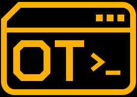
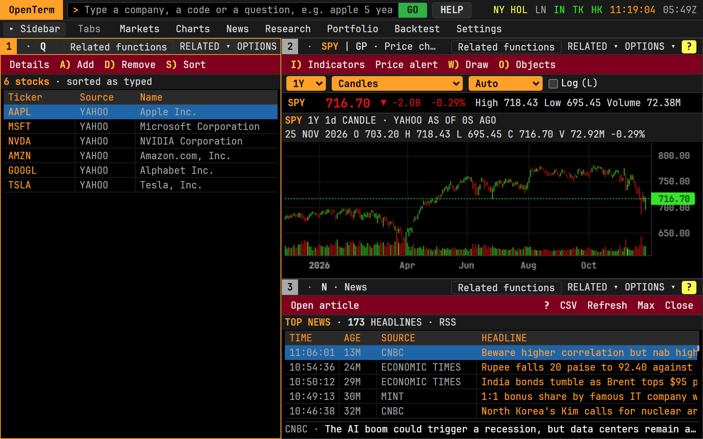
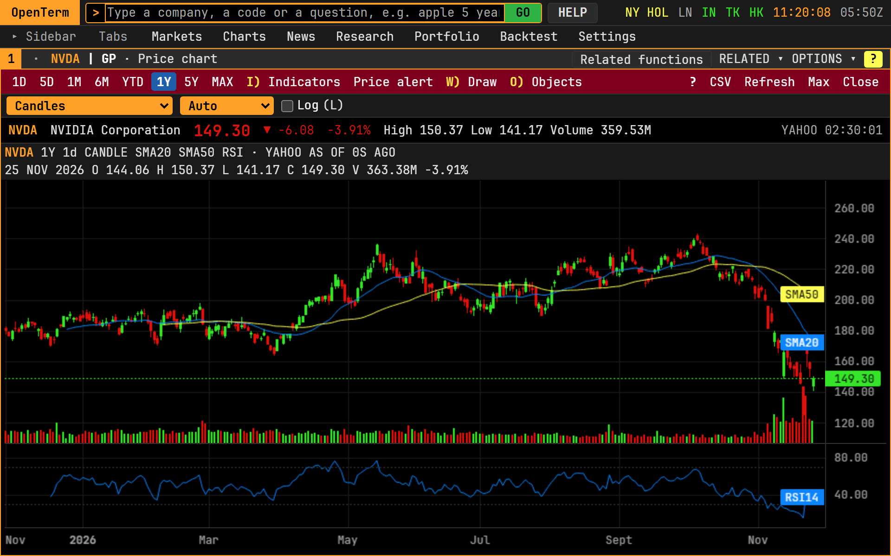
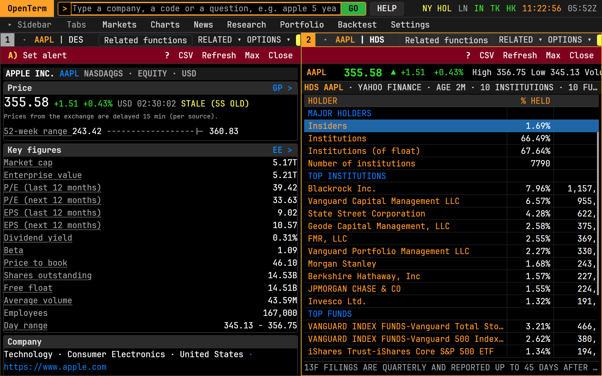
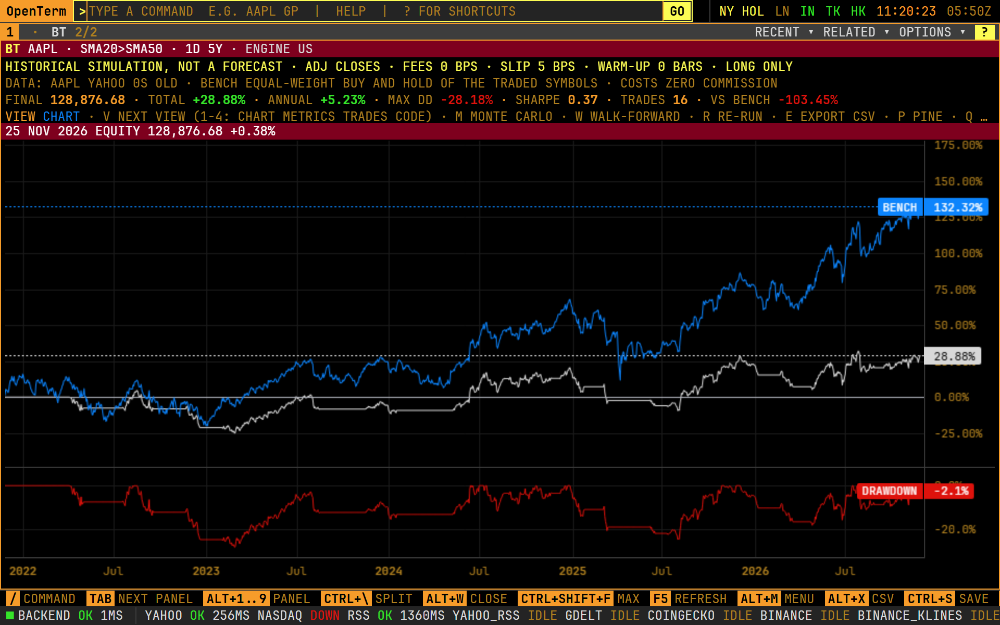

<div align="center">



# OpenTerm

**A free, open-source market terminal that runs on your own computer.**

Quotes, charts, company filings, macro data, stock screens and backtests behind one command line.<br>
No account, no subscription and no API key needed.

[](LICENSE)
[](docs/PERFORMANCE.md)
[](#api-keys)
[](backend/pyproject.toml)
[](frontend/package.json)

[Install](#install) ·
[First steps](#first-steps) ·
[User guide](docs/GUIDE.md) ·
[Features](#features) ·
[Screenshots](#screenshots) ·
[Docs](#documentation)

<br>



</div>

## What it is

OpenTerm is a market terminal: one screen for live prices, charts, company accounts, news and economic data. You type a
ticker and a short code, and a panel opens. `AAPL GP` shows Apple's price chart. `AAPL DES` shows the company profile.
You can also type in plain English, such as `apple stock price past 5 years`.

It runs on free public data sources, on your own machine. Your layouts, watchlists and API keys stay there.

> [!NOTE]
> **Not investment advice.** The free data sources can be delayed, incomplete or wrong, and they can change or block
> access at any time. Backtests are historical simulations, not forecasts. OpenTerm never places real orders. It is
> not affiliated with any commercial terminal vendor.

## Install

You need two free tools:

- **[uv](https://docs.astral.sh/uv/)** runs the Python part. It downloads the right Python version by itself.
- **[Node.js](https://nodejs.org/) 20 or newer** builds the screen.

**Git** is optional. The finished install uses about 330 MB of disk space.

<details open>
<summary><b>Windows</b> (PowerShell)</summary>

```powershell
winget install --id astral-sh.uv -e
winget install --id OpenJS.NodeJS.LTS -e
winget install --id Git.Git -e
```

Close PowerShell and open it again. Then run:

```powershell
git clone https://github.com/ImTheRealARB/OpenTerm.git
cd OpenTerm
.\scripts\setup.ps1
.\scripts\start.ps1
```

If Windows says "running scripts is disabled", run `Set-ExecutionPolicy -Scope CurrentUser RemoteSigned` once, then
try again.

</details>

<details>
<summary><b>macOS</b> (Terminal, with <a href="https://brew.sh">Homebrew</a>)</summary>

```sh
brew install uv node git
git clone https://github.com/ImTheRealARB/OpenTerm.git
cd OpenTerm
./scripts/setup
./scripts/start
```

</details>

<details>
<summary><b>Linux</b></summary>

Install `git`, `curl` and Node.js 20 or newer with your package manager. The Node.js package on Debian and Ubuntu is
often too old, so use [nvm](https://github.com/nvm-sh/nvm) (`nvm install --lts`). Then run:

```sh
curl -LsSf https://astral.sh/uv/install.sh | sh
git clone https://github.com/ImTheRealARB/OpenTerm.git
cd OpenTerm
./scripts/setup
./scripts/start
```

On a server with no desktop, run `./scripts/start --no-browser` and open the address from another computer.

</details>

OpenTerm opens in your browser at **http://localhost:8000**. Keep the terminal window open while you use it. To stop
OpenTerm, press `Ctrl+C` in that window.

| To do this | Do this |
|---|---|
| Install without Git | Click **Code**, then **Download ZIP**. On Windows, open the ZIP's Properties and tick **Unblock** before you unzip it. Run the same `setup` and `start` commands in the folder. |
| Update | Run `git pull`, then start OpenTerm as usual. The start script rebuilds what changed. |
| Start it from any terminal | Run `.\scripts\install-launcher.ps1` (macOS and Linux: `./scripts/install-launcher`) once. After that, type `openterm`. |

> [!IMPORTANT]
> OpenTerm is developed and tested on Windows. The macOS and Linux scripts have not been run on those systems yet. If
> something fails, please [open an issue](https://github.com/ImTheRealARB/OpenTerm/issues) and include the error text.

## First steps

OpenTerm starts in **GUI mode**, with a sidebar that lists every screen. Click a screen, or type in the command line at
the top and press `Enter`. Try these:

| Type | You get |
|---|---|
| `AAPL DES` | Apple's company profile, valuation and 52-week range |
| `AAPL GP 5Y` | Apple's price chart for the last five years |
| `apple vs microsoft since 2021` | Apple and Microsoft on one chart |
| `tesla news` | Tesla headlines |
| `WEI` | World stock indices, live |
| `amazon balance sheet` | Amazon's balance sheet from its SEC filings |
| `tech stocks under 50 dollars` | A stock screen |
| `HELP` | A list of every function. `HELP GP` explains one function. |

Plain English is read by fixed rules on your computer, not by an AI, so it costs nothing and answers at once. Exact
codes such as `AAPL GP` always run as typed.

**Terminal mode** shows only the command line and the panels. Press `Alt+G` to switch between the two modes.

The **[user guide](docs/GUIDE.md)** explains the screen, the command line, panels and layouts, and every function in
plain words.

## Features

| Area | What you can do |
|---|---|
| **Charts and quotes** | Chart any ticker with 16 chart types, 109 indicators and 30 drawing tools. Replay old price bars to practise. Watch live boards for stocks, indices, currencies, commodities and crypto. |
| **Companies** | Read company profiles, financial statements, SEC filings, insider trades, holders, analyst estimates and peer comparisons. Run a DCF valuation. |
| **Screens** | Filter the whole US stock universe. Scan indices and watchlists for indicator signals. Query data with `QRY` from OpenTerm, Python or Excel. |
| **Macro** | Chart FRED series, yield curves, inflation, jobs and GDP data. Read earnings, economic and central-bank calendars. |
| **India** | Follow NSE and BSE shares, indices, futures and options. A paid [Zerodha Kite Connect](https://kite.trade/) app adds real-time data. OpenTerm only reads from Kite. |
| **Options and crypto** | Read option chains, implied volatility and payoff charts. Watch crypto order books, funding rates and DeFi yields. |
| **Portfolios and backtests** | Track positions with live profit and loss. Test a trading rule on past prices, with fees and slippage. Write rules as one line or in Python. |
| **Risk and AI** | Measure portfolio risk and run optimisations. With an AI provider key, ask questions about the data. Each answer shows which data it used. |

[docs/FUNCTIONS.md](docs/FUNCTIONS.md) lists all 179 functions with their arguments.

## Screenshots

<table>
<tr>
<td width="50%"><br><sub><b>HOME</b>: markets by region, headlines and a ticker tape</sub></td>
<td width="50%"><br><sub><b>GP</b>: candles with moving averages and RSI</sub></td>
</tr>
<tr>
<td><br><sub><b>DES + HDS</b>: company profile and top holders</sub></td>
<td><br><sub><b>RATES + FRED</b>: rates board and US CPI</sub></td>
</tr>
<tr>
<td><br><sub><b>BT</b>: a backtest with fees and slippage</sub></td>
<td><br><sub><b>BT EDIT</b>: a strategy written in Python</sub></td>
</tr>
</table>

## Performance

Each change must pass a benchmark (`node scripts/bench.mjs`) with fixed time budgets. These results are from a Windows
PC on 5 November 2026. The full record is in [docs/PERFORMANCE.md](docs/PERFORMANCE.md).

| Action | Result | Budget |
|---|---|---|
| Open the app until the command line is usable | about 95 ms | 1,500 ms |
| Press a key until it shows on screen | about 15 ms | 16.7 ms |
| Run a cached command until the panel shows | about 18 ms | 100 ms |
| Receive a live price until the screen updates (4,000 prices a second, 9 panels) | about 37 ms | 50 ms |
| Scroll a 10,000-row table or pan a 50,000-candle chart | 16.7 ms a frame | 20 ms |
| Backtest 10 years of daily prices | about 0.28 s | 0.3 s |
| Download the app (compressed) | about 120 KB | 400 KB |

OpenTerm has no animations, shadows or web fonts. It draws tables and charts on a canvas, applies live prices once
per screen frame, and runs heavy calculations in separate processes, so typing never waits.

## Data sources

OpenTerm uses free public sources, such as Yahoo Finance, Nasdaq, SEC EDGAR, FRED, the US Treasury and Binance. These
sources are for personal use, and they can change without notice.

- Each value shows its source and its age.
- If a source fails, the panel shows `STALE`, `ERR` or `PROVIDER DOWN`. It never shows an invented number.
- If one source fails, the next source in a fixed order answers, and the panel names it.
- Test data always has a label on screen.

Read [docs/DATA_LIMITS.md](docs/DATA_LIMITS.md) before you rely on any value, and respect each source's terms.

## API keys

OpenTerm works with no keys. A key adds more data. Paste keys into the `APIKEYS` panel, which also links to each
sign-up page. OpenTerm keeps keys in your computer's secure store and sends each key only to its own provider.

| Key | What it adds |
|---|---|
| Finnhub, FMP, Alpaca | Estimates, recommendations, IPOs, real-time US quotes and news |
| FRED, EIA, BLS, BEA, Census | Series titles and search, energy, US jobs, prices, GDP and trade |
| Kite Connect (paid) | Real-time Indian market data. The login lasts one trading day, then Yahoo takes over. |
| UN Comtrade, Companies House, Etherscan, AISstream, Marketaux | Trade flows, UK companies, Ethereum, live ship positions, news sentiment (all free) |
| An AI provider (OpenRouter, Anthropic, OpenAI, OpenCode Go and others) | The optional AI panels. The provider bills you directly. |
| Telegram, email or a webhook | Alerts and a daily brief sent to you (off by default) |

The SEC asks every program to identify itself. For `FA`, `FIL` and `OWN`, set
`SEC_USER_AGENT="Your Name you@example.com"` in the `.env` file that setup created, then restart OpenTerm.

## Documentation

| Use OpenTerm | Data | Extend and connect |
|---|---|---|
| [User guide](docs/GUIDE.md) | [Data sources](docs/DATA_SOURCES.md) | [REST API](docs/API.md) |
| [Every function and key](docs/FUNCTIONS.md) | [Data limits](docs/DATA_LIMITS.md) | [Python SDK](docs/SDK.md) |
| [Commands to try](docs/COMMANDS.md) | [Performance record](docs/PERFORMANCE.md) | [Excel bridge](docs/EXCEL.md) |
| [Trade journal (`JRNL`)](docs/JOURNAL.md) | [Third-party code and licences](THIRD_PARTY.md) | [MCP server for AI assistants](docs/MCP.md) |
| [AI web access](docs/AI_WEB.md) | [Vibe-Trading porting notes](docs/porting/) | [Extensions](docs/EXTENSIONS.md) |
| [Host your own copy](docs/HOSTING.md) | | [Development](docs/DEVELOPMENT.md) |
| [Desktop app and Docker](docs/DESKTOP.md) | | [Design rules](DESIGN.md) |
| [Release notes](docs/RELEASE_NOTES.md) · [Changelog](CHANGELOG.md) | | |

## Contributing

Bug reports and pull requests are welcome. [docs/DEVELOPMENT.md](docs/DEVELOPMENT.md) explains how to run OpenTerm
from source, run the tests and add a function.

## Licence and credits

OpenTerm is released under the [MIT licence](LICENSE). Charts use
[TradingView Lightweight Charts™](https://www.tradingview.com/lightweight-charts/) (Apache-2.0, copyright © TradingView,
Inc.). The backtest engine and quant library include code ported from
[Vibe-Trading](https://github.com/HKUDS/Vibe-Trading) (MIT). [THIRD_PARTY.md](THIRD_PARTY.md) lists every ported file.
