# OpenTerm user guide

This guide explains how to use OpenTerm. It starts with the screen and the command line, then shows common tasks step
by step, and ends with a plain-English list of every function.

You need no finance-terminal experience. If you have not installed OpenTerm yet, follow the
[install steps in the README](../README.md#install).

The screenshots use OpenTerm's recorded test data (`OPENTERM_FIXTURES=1`), so the numbers in them are old and each
panel shows a test-data label. Your screen shows current data.

## Contents

1. [Start and stop OpenTerm](#start-and-stop-openterm)
2. [The screen](#the-screen)
3. [Run a command](#run-a-command)
4. [Work with panels](#work-with-panels)
5. [Common tasks](#common-tasks)
6. [Status labels](#status-labels)
7. [Settings, themes and API keys](#settings-themes-and-api-keys)
8. [Keyboard shortcuts](#keyboard-shortcuts)
9. [Every function](#every-function)
10. [Troubleshooting](#troubleshooting)
11. [Words used in this guide](#words-used-in-this-guide)

## Start and stop OpenTerm

**To start OpenTerm:**

1. Open PowerShell (macOS and Linux: Terminal) in the OpenTerm folder.
2. Run `.\scripts\start.ps1` (macOS and Linux: `./scripts/start`).
3. Wait for your browser to open at http://localhost:8000.

If you ran `.\scripts\install-launcher.ps1` once, you can type `openterm` in any terminal instead.

**To stop OpenTerm:** press `Ctrl+C` in the terminal window. Closing the browser tab does not stop OpenTerm.

Your layouts, watchlists, portfolios and alerts stay on your computer, in `data/openterm.db`. They are there the next
time you start OpenTerm.

## The screen

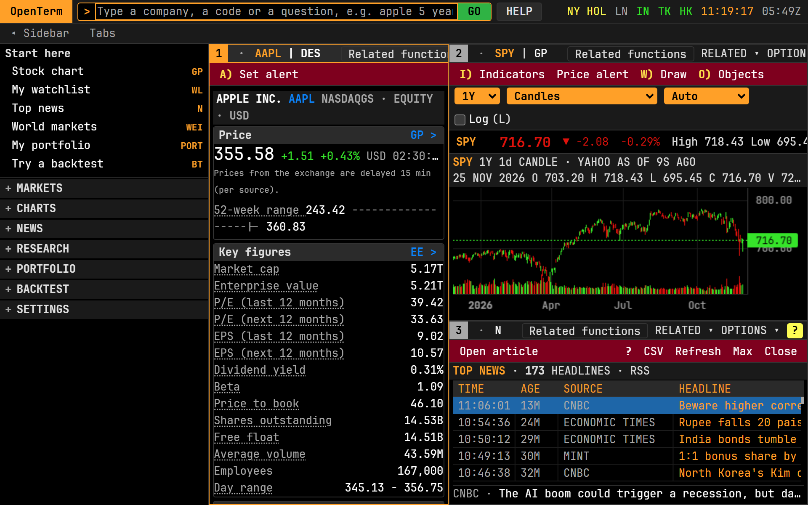

The screen has three parts:

| Part | What it does |
|---|---|
| **Command line** (top) | You type commands here. A command opens a panel. The market clocks are on the right. |
| **Panels** (centre) | Each panel shows one function, such as a chart or a news list. You can show up to 9 panels at once. |
| **Status bar** (bottom) | Shows the main keys and the health of each data source. |

### GUI mode and Terminal mode

OpenTerm has two modes. Both show the same data. Press `Alt+G` to switch between them.

- **GUI mode** is the default. It adds a menu bar, a sidebar with every screen grouped by topic, and buttons on each
  panel. Start here if you are new.
- **Terminal mode** shows only the command line and the panels. Use it when you know the codes and want more room.

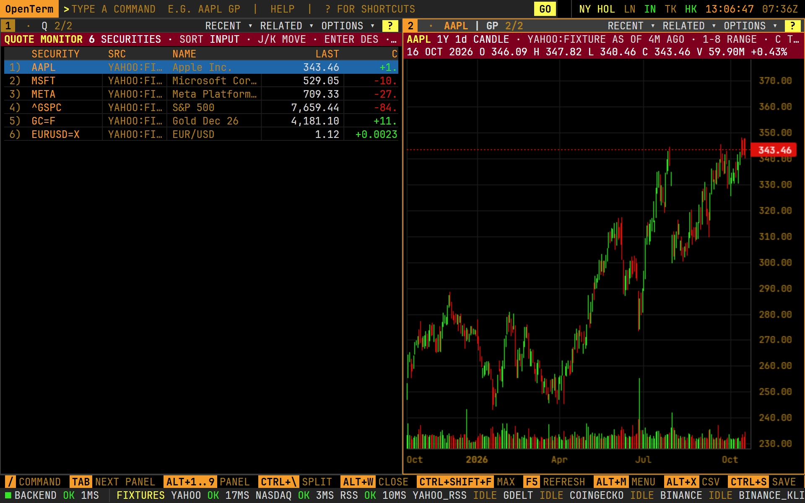

### Help on screen

- Hover a term such as P/E or EPS to see a one-line explanation.
- Click `?` on a panel, or press `Alt+H`, to open help for that panel.
- Each panel's toolbar shows its actions with their keys.
- Type `HELP` to list every function. Type `HELP GP` to read about one function.
- Press `?` to see every keyboard shortcut.

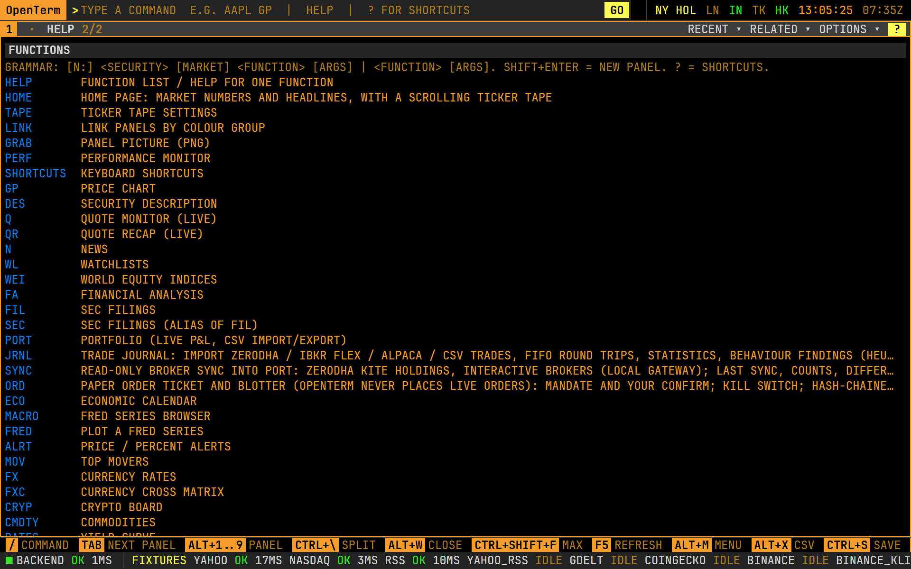

## Run a command

### The basic pattern

Most commands are a ticker followed by a function code:

```text
AAPL DES        Apple's company profile
AAPL GP         Apple's price chart
MSFT FA         Microsoft's financial statements
```

Some functions are about the whole market, not one company. Type the code alone:

```text
WEI             world stock indices
N               top news
RATES           the US Treasury yield curve
```

Many functions take extra words, called arguments, after the code:

```text
AAPL GP 5Y W LOG     5 years of weekly prices on a log scale
ERN TOMORROW         tomorrow's earnings reports
```

The full pattern is:

```text
[PANEL:] [TICKER] [MARKET] FUNCTION [ARGUMENTS]
```

The ticker always comes first: type `AAPL DES`, not `DES AAPL`.

### Run it

1. Press `/` or `Ctrl+K` to put the cursor in the command line. You can also click it or start to type.
2. Type the command.
3. Press `Enter` to show the result in the focused panel. Press `Shift+Enter` to open it in a new panel.

To send a command to a specific panel, start it with the panel number: `2: MSFT DES` opens in panel 2.

### Suggestions and history

- While you type, a list of matching tickers and functions appears. Press `Tab` to accept a suggestion.
- Press `Up` and `Down` to move through suggestions, or through the commands you ran before.
- Type part of a company name, such as `relian`, to find its ticker (`RELIANCE.NS`).

### The panel remembers its ticker

Each panel remembers the last ticker you used in it. If a panel shows `AAPL DES`, type `GP` alone to chart AAPL in that
panel.

### Markets outside the US

Add a market code after the ticker, or type the full Yahoo ticker:

| Market | Code | Example |
|---|---|---|
| India, NSE | `IN` or `NS` | `RELIANCE IN DES` or `RELIANCE.NS DES` |
| India, BSE | `BO` | `RELIANCE BO GP` |
| London | `LN` | `VOD LN GP` |
| Tokyo | `JP` | `7203 JP GP` |
| Hong Kong | `HK` | `700 HK GP` |
| Germany | `GR` | `SAP GR GP` |
| China | `CN` | `600519 CN GP` |
| Australia | `AU` | `BHP AU GP` |

Short names work for common indices and pairs: `SPX`, `NDX`, `NIFTY`, `SENSEX`, `EURUSD`, `BTCUSD`.

### Plain English

You can type a request in plain words. OpenTerm turns it into a command:

| Type | OpenTerm runs |
|---|---|
| `apple stock price past 5 years` | `AAPL GP 5Y` |
| `tesla news` | `TSLA N` |
| `amazon balance sheet` | `AMZN FA BS` |
| `tech stocks under 50 dollars` | `EQS` with a sector and a price filter |

Fixed rules on your computer read plain English. No AI is involved, so it is free and instant. If a name matches
several companies, OpenTerm asks which one you mean. Exact codes always run as typed.

## Work with panels

### Arrange panels

| To do this | Press |
|---|---|
| Split the focused panel side by side | `Ctrl+\` |
| Split the focused panel top and bottom | `Ctrl+-` |
| Focus panel 1 to 9 | `Alt+1` to `Alt+9` |
| Focus the next panel | `Tab` |
| Close the focused panel | `Alt+W` |
| Make the focused panel fill the screen, or restore it | `Ctrl+Shift+F` |
| Move the divider between panels | `Ctrl+Shift+Arrow keys` |
| Go back or forward in the panel's history | `Ctrl+[` and `Ctrl+]` |

### The window menu

Press `Alt+M` to open the window menu, or click RECENT, RELATED or OPTIONS in the panel's title bar. It has three lists:

- **RECENT** shows what this panel showed before. Pick one to go back to it.
- **RELATED** shows other functions for the same ticker, such as the chart, the news or the holders.
- **OPTIONS** maximizes, splits, refreshes, exports or closes the panel.

Use the arrow keys and `Enter` to pick an item, or press its number. Press `Esc` to close the menu.

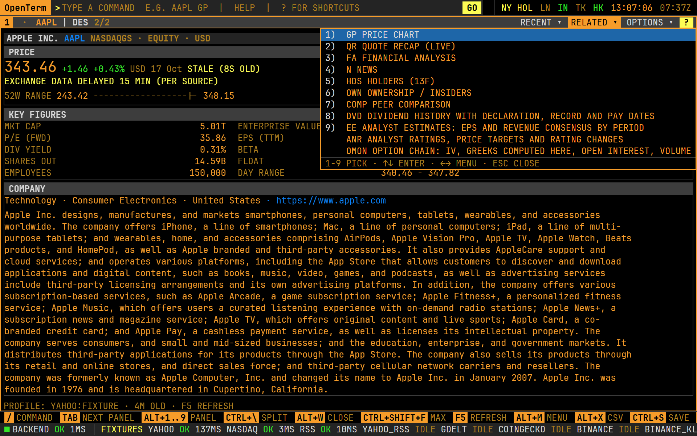

### Save a layout

A layout is a saved set of panels.

1. Arrange the panels that you want.
2. Type `LAYOUT SAVE MYDESK` and press `Enter`.

To open it later, type `LAYOUT MYDESK`. Type `LAYOUT` to list your layouts. After you save a layout, `Ctrl+S` saves
it again and `Ctrl+O` opens a layout.

`TMPL` offers ready-made layouts for day trading, long-term investing, macro and India.

### Keys inside a panel

The focused panel receives plain keys first. In a table or a chart, a letter is a panel key. To type a command there,
press `/` or `Ctrl+K` first.

| Key | In tables and lists |
|---|---|
| `J` / `K` or `Down` / `Up` | Move the cursor |
| `PageDown` / `PageUp` | Move one page |
| `Enter` | Open the selected row, usually its chart or its details |
| `E` or `Alt+X` | Export the table to a CSV file |
| `F5` | Refresh the data |
| `Alt+P` | Copy a picture of the panel |

In a chart, `1` to `8` change the date range. Each panel lists its own keys in its toolbar.

## Common tasks

### Research a company

1. Type `AAPL DES` to read the company profile, valuation and 52-week range.
2. Type `FA` to see the income statement. Add `BS` for the balance sheet or `CF` for the cash flow. Add `Q` for
   quarterly numbers.
3. Type `FIL` to list the company's SEC filings. Press `Enter` on a filing to read it.
4. Type `HDS` to see the largest holders, or `OWN` to see insider trades.
5. Type `ANR` for analyst ratings and price targets, or `COMP` to compare the company with its peers.

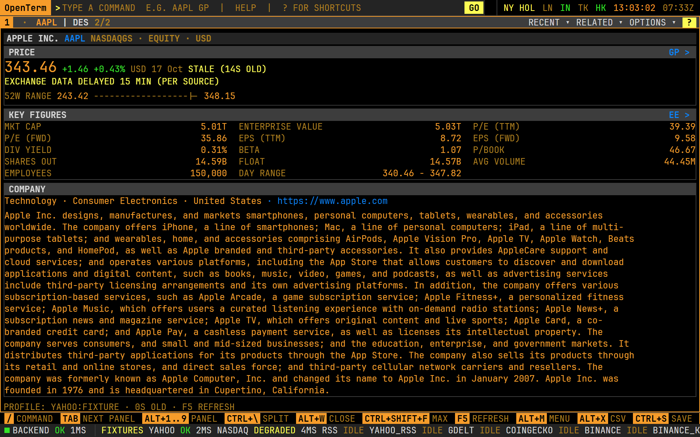

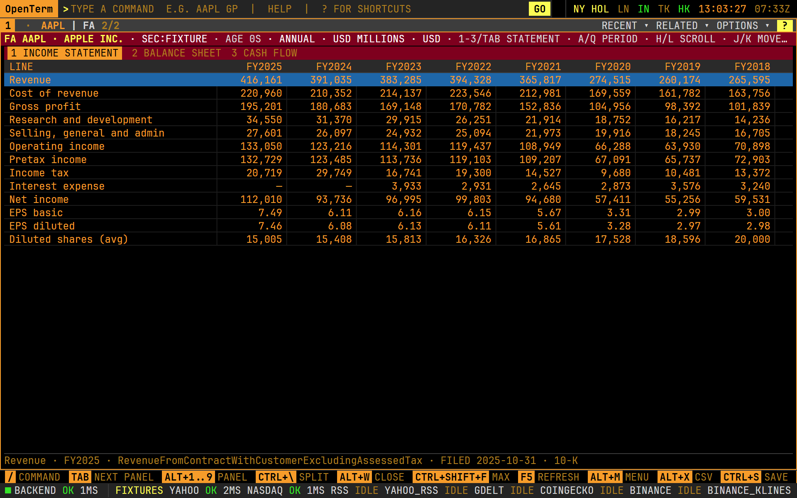

`FA`, `FIL` and `OWN` read SEC EDGAR. The SEC asks each program to identify itself, so set `SEC_USER_AGENT` first. The
[API keys](#api-keys) section explains how.

### Chart a price

Type `AAPL GP` for a one-year daily chart. Add arguments to change it:

| Add | Effect | Example |
|---|---|---|
| A date range | `1D`, `5D`, `1M`, `3M`, `6M`, `1Y`, `5Y`, `MAX` | `AAPL GP 5Y` |
| A bar size | `D` (daily), `W` (weekly), `MO` (monthly), `5MIN`, `1H` | `AAPL GP 5D 15MIN` |
| Indicators | `SMA20`, `SMA50`, `EMA20`, `BB`, `RSI`, `MACD`, `VWAP` and more | `AAPL GP 1Y SMA50 RSI` |
| A comparison | `VS` and a second ticker, shown as percent change | `AAPL GP VS SPY` |
| A log scale | `LOG` | `AAPL GP MAX LOG` |

Keys in a chart:

| Key | Effect |
|---|---|
| `1` to `8` | Change the date range |
| `C` | Change the chart type |
| `I` | Add or remove indicators |
| `Left` / `Right` | Move back or forward in time |
| `+` / `-` | Zoom in or out |
| `X` | Show a crosshair with the open, high, low, close and volume |
| `L` | Switch the log scale on or off |
| `A` | Set a price alert at the crosshair |

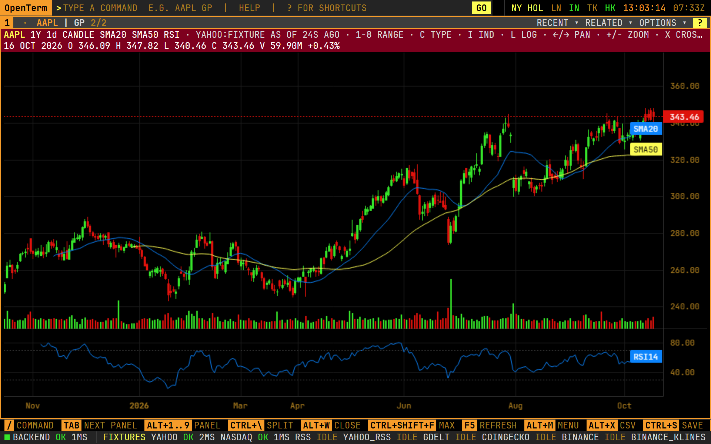

`IND` opens the indicator library, with 109 indicators and your own formulas.

### Watch the markets

| Type | You get |
|---|---|
| `Q AAPL MSFT NVDA` | A live quote monitor for the tickers you name. `Q` alone shows a default list. |
| `WEI` | World stock indices |
| `FX` | Currency rates. `FXC USD EUR INR` shows a cross-rate table. |
| `CMDTY` | Commodities |
| `CRYP` | Crypto prices. `CRYP INR` shows them in rupees. |
| `MOV GAINERS` | The day's largest gainers. Also `LOSERS` and `ACTIVE`. |

In a quote monitor, press `A` to add a ticker, `D` to delete one and `S` to sort.

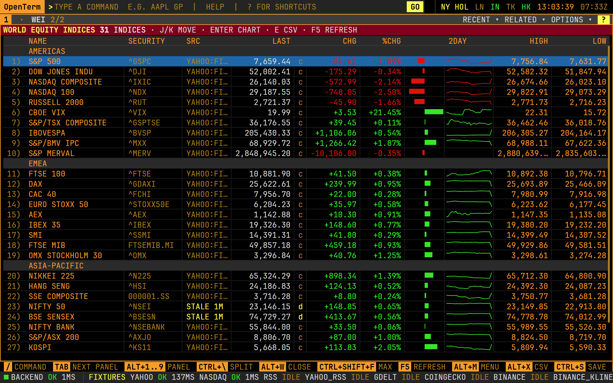

### Read the news

| Type | You get |
|---|---|
| `N` | Top market news |
| `AAPL N` | News about one company |
| `N TECH` | News by section: `MARKETS`, `ECONOMY`, `COMPANIES`, `COMMODITIES`, `CRYPTO`, `TECH`, `INDIA`, `WORLD` |
| `N COUNTRY IN` | News by country |
| `N SEARCH rate cut` | Headlines that contain all of these words |

Press `Enter` on a headline to read it.

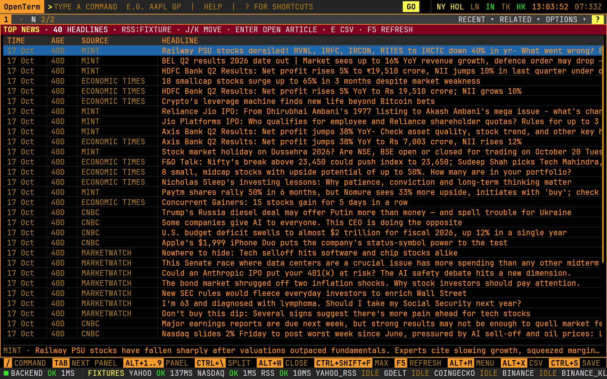

### Find stocks

`EQS` screens the whole US stock universe. Add filters after the code:

```text
EQS SECTOR=TECH MCAP>100B SORT=PCT
EQS PRICE<50 VOL>1M COUNTRY=US
```

`MCAP` is market value, `PCT` is the day's percent change and `VOL` is volume. Press `Enter` on a row to open that
stock.

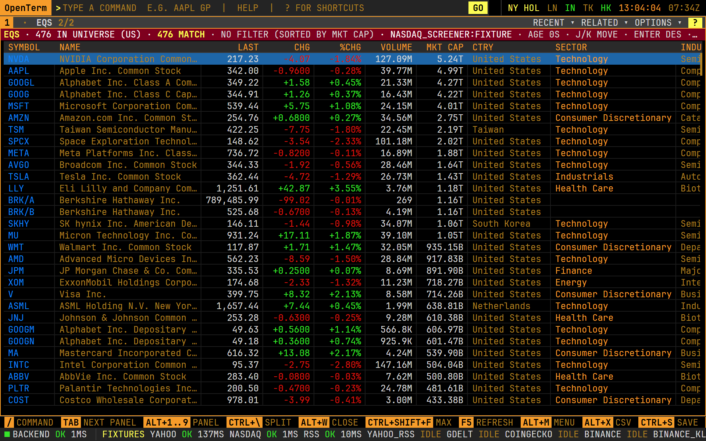

`IMAP` shows the same universe as a heat map. `SECF` finds a ticker from a company name or an ISIN code.

### Follow the economy

| Type | You get |
|---|---|
| `RATES` | The US Treasury yield curve and spreads |
| `FRED CPIAUCSL` | A chart of any FRED series. This one is US consumer prices. |
| `MACRO` | A list of common FRED series |
| `ECO 30 MAJOR` | Major US economic releases in the next 30 days |
| `ERN TODAY` | Companies that report earnings today |
| `CENB` | Central bank rates and their next decision dates |

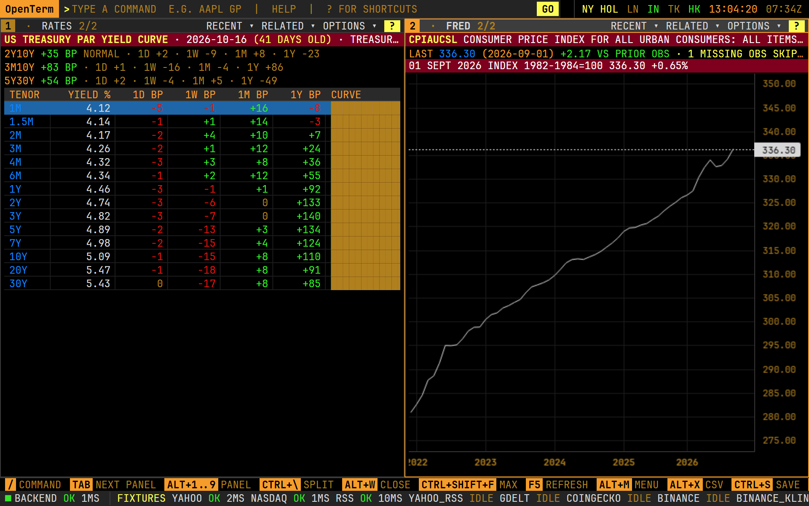

### Read an option chain

Type `AAPL OMON` to see Apple's options for the nearest expiry date. The table shows each strike's price, implied
volatility, Greeks, open interest and volume. Add a date, such as `AAPL OMON 2026-12-18`, for another expiry.

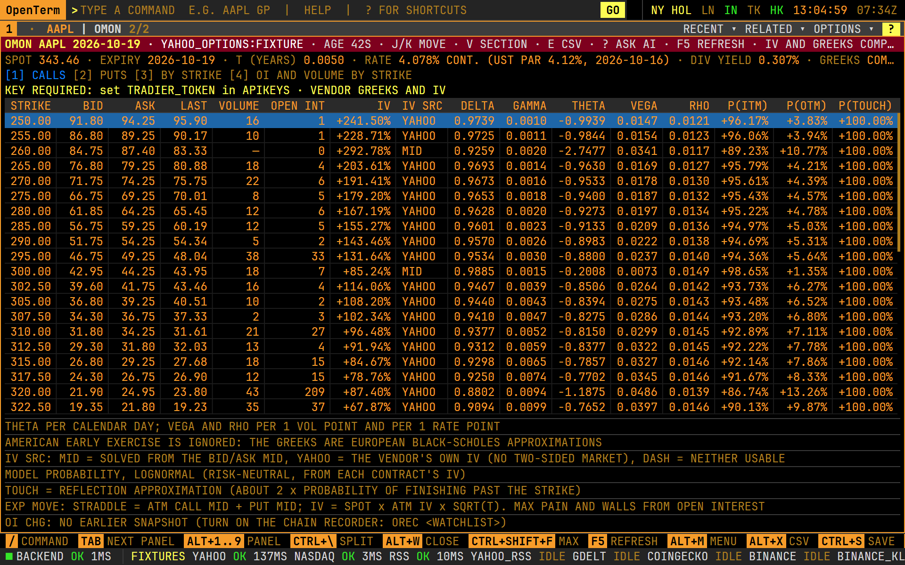

### Track a portfolio

1. Type `PORT MAIN ADD AAPL 50 180` to add 50 Apple shares bought at $180 to a portfolio called MAIN.
2. Add more positions the same way.
3. Type `PORT MAIN` to see the live value and profit or loss of each position.

`PORT MAIN EXPORT` and `PORT MAIN IMPORT` move positions to and from a CSV file. `PORT MAIN BASE INR` shows the totals
in rupees.

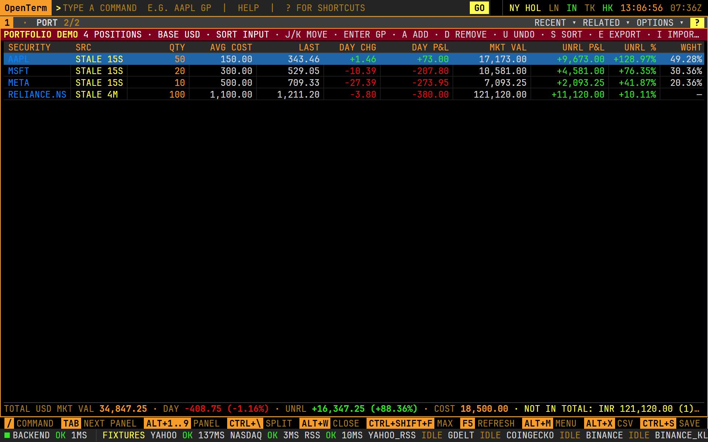

### Set an alert

| Type | Effect |
|---|---|
| `ALRT AAPL > 250` | Alerts you when Apple trades above 250 |
| `ALRT MSFT -5%` | Alerts you when Microsoft falls 5% from the previous close |
| `ALRT` | Lists your alerts |
| `ALRT DEL 3` | Deletes alert number 3 |

The OpenTerm server checks alerts, so they work while the browser is closed. They do not work while OpenTerm is
stopped. `DLVR` sends alerts to Telegram, email or a webhook.

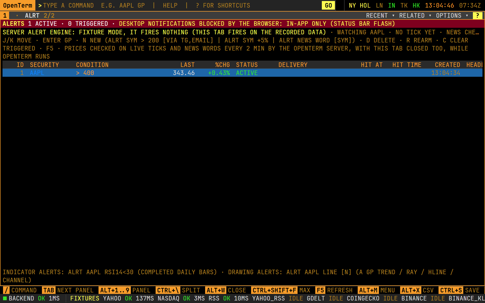

### Keep a watchlist

Type `WL TECH ADD AAPL MSFT NVDA` to create a watchlist called TECH. Type `WL TECH` to open it. Type `WL DEL TECH` to
delete it.

### Test a trading rule

`BT` tests a rule on past prices. This command buys Apple when its 20-day average rises above its 50-day average, on 5
years of daily prices:

```text
BT AAPL SMA20>SMA50 1D 5Y
```

The result shows the equity curve, the statistics and each trade. Press `V` to switch between these views. Add
`FEES=5` for fees in basis points (hundredths of a percent), or `SHORT` to allow short sales.

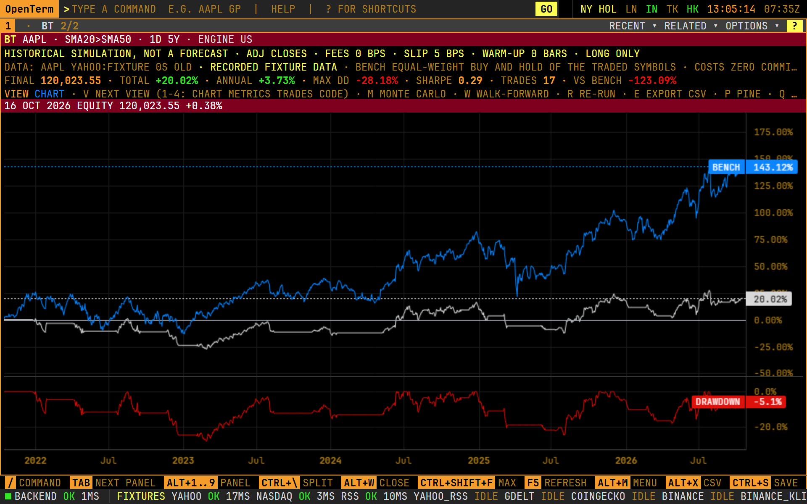

A rule can use `CLOSE`, `OPEN`, `HIGH`, `LOW`, `VOLUME`, averages such as `SMA20` and `EMA50`, `RSI14`, numbers, the
signs `>` `<` `>=` `<=`, and the words `AND` and `OR`. Orders fill at the next bar's open.

`BT EDIT mystrategy` opens a Python editor for rules that one line cannot express.

> [!NOTE]
> A backtest is a historical simulation, not a forecast. Each result says so and lists its data source, fees and
> slippage.

### Ask the AI (optional)

The AI functions need a key from an AI provider, such as OpenRouter. Add it in `APIKEYS`. The provider bills you
directly.

Type `AI` and a question, such as `AI how did Apple's margins change over 5 years?`. The answer lists the OpenTerm data
that it used. An answer that used no data says `UNGROUNDED`. AI output is model output, not data, so check it.

### Export data

- Press `E` or `Alt+X` in any table to save it as a CSV file.
- Press `Alt+P` to copy a picture of the focused panel. Type `GRAB SAVE` to download the picture.

## Status labels

OpenTerm never shows an invented number. When something is wrong, the panel says so with one of these labels:

| Label | Meaning | What to do |
|---|---|---|
| `STALE` | The data is older than usual. The panel shows its age. | Wait, or press `F5`. |
| `ERR` | The request failed. The panel shows why. | Read the message. Press `F5` to try again. |
| `PROVIDER DOWN` | The data source does not answer. | Type `SOURCES` to see which source is down. OpenTerm tries again by itself. |
| `KEY REQUIRED` | This function needs an API key. | Add the key in `APIKEYS`. |
| `FIXTURE MODE`, `RECORDED` or `SYNTHETIC` | This is test data, not market data. | Start OpenTerm without `OPENTERM_FIXTURES` or `OPENTERM_SYNTHETIC`. |
| `HISTORICAL SIMULATION, NOT A FORECAST` | A backtest result. | No action. |
| `UNGROUNDED` | An AI answer that used no OpenTerm data. | Treat it with care. |

Each value also shows its source and age. If one source fails, the next source answers, and the panel names it.

## Settings, themes and API keys

| Type | Effect |
|---|---|
| `SETTINGS` | Opens all settings: vim keys, clocks, number format, refresh rates and key bindings |
| `THEME GREEN` | Changes the colours. Choose `AMBER`, `GREEN`, `WHITE` or `LIGHT`. |
| `SETTINGS FONT Fira Code` | Changes the font. `SETTINGS FONT NEXT` steps through the presets. |
| `SETTINGS KEYS` | Changes a keyboard shortcut |
| `SETTINGS MODE TERMINAL` | Switches to Terminal mode, the same as `Alt+G` |
| `SOURCES` | Shows the health and speed of each data source |

### API keys

OpenTerm works with no API keys. A key adds more data or features. To add one:

1. Type `APIKEYS` and press `Enter`.
2. Select the provider and press `Enter`.
3. Paste the key into the masked field.
4. Press `T` to test the key.

Press `O` on a provider to open its sign-up page. OpenTerm keeps keys in your computer's secure store. Never type a key
in the command line.

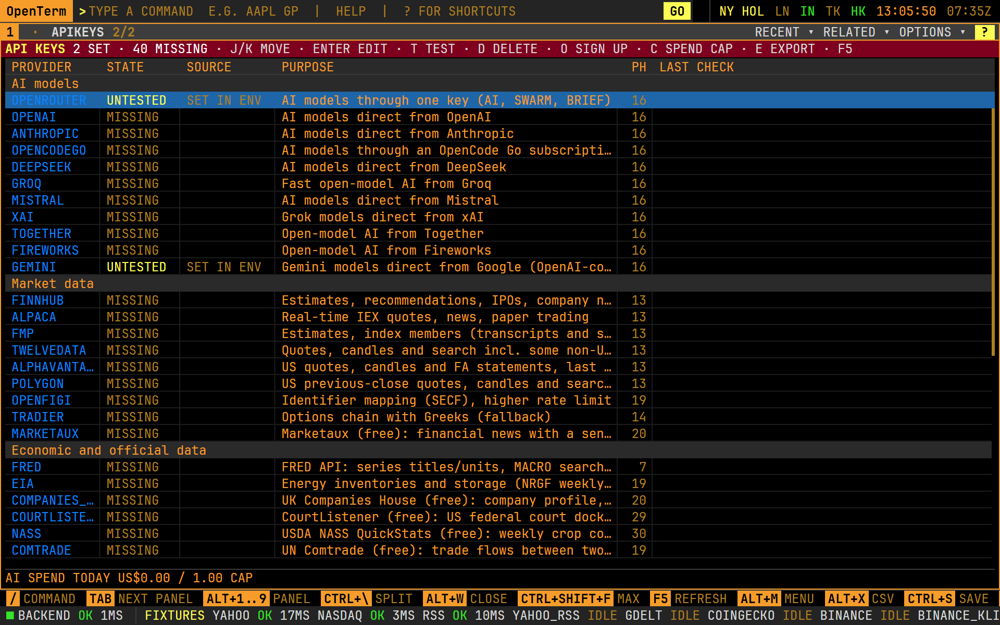

For `FA`, `FIL` and `OWN`, the SEC needs your name and email:

1. Open the `.env` file in the OpenTerm folder. Setup created it.
2. Add the line `SEC_USER_AGENT="Your Name you@example.com"`.
3. Restart OpenTerm.

## Keyboard shortcuts

Press `?` in OpenTerm for the full list. Change any shortcut with `SETTINGS KEYS`.

| Keys | Action |
|---|---|
| `/`, `` ` `` or `Ctrl+K` | Put the cursor in the command line |
| `Enter` / `Shift+Enter` | Run a command in the focused panel / in a new panel |
| `Esc` | Close a menu or leave the command line |
| `Alt+1` to `Alt+9` | Focus a panel |
| `Tab` / `Shift+Tab` | Focus the next / previous panel |
| `Ctrl+\` / `Ctrl+-` | Split a panel side by side / top and bottom |
| `Alt+W` | Close the focused panel |
| `Ctrl+Shift+F` | Maximize or restore the focused panel |
| `Ctrl+[` / `Ctrl+]` | Go back / forward in the panel's history |
| `F5` | Refresh the focused panel |
| `Ctrl+S` / `Ctrl+O` | Save the layout again / open a layout |
| `Alt+M` | Open the window menu |
| `Alt+G` | Switch between GUI mode and Terminal mode |
| `Alt+H` | Open help for the focused panel (GUI mode) |
| `Alt+X` | Export the focused table to CSV |
| `Alt+P` | Copy a picture of the focused panel |
| `?` | Show all shortcuts |

Browsers keep `Ctrl+W`, `Ctrl+T` and `Ctrl+1` to `Ctrl+9` for themselves. Use the `Alt` keys instead.

## Every function

Each row says what the function shows, in plain words, with a command to try. Functions marked with a ticker in
the example need one. [FUNCTIONS.md](FUNCTIONS.md) lists every argument of every function.

### Markets: Stocks and funds

| Code | What it does | Try |
|---|---|---|
| `Q` | Shows a live table of prices for the tickers you list. | `Q AAPL MSFT` |
| `QR` | Shows a live quote summary for one ticker. | `AAPL QR` |
| `WL` | Shows your watchlists (saved lists of tickers) with live prices. Adds or removes tickers. | `WL TECH ADD AAPL MSFT` |
| `WEI` | Shows live levels of the main stock indices (baskets of stocks that track a market) around the world. | `WEI` |
| `MOV` | Lists the biggest gainers, biggest losers or most active stocks today. | `MOV GAINERS` |
| `EQS` | Filters US stocks by sector, market cap (company value), price, volume and ratios such as return on equity. | `EQS SECTOR=TECH MCAP>10B PCT>2` |
| `FSRC` | Filters US ETFs (funds that trade like stocks) by fee, size and category. Results show PARTIAL until loading ends. | `FSRC FEE<0.2 AUM>1B` |
| `SCAN` | Tests a list of tickers against a rule, such as RSI (a momentum measure) or moving averages. Saves scans to run daily. | `SCAN SPX RSI14<30 AND CLOSE>SMA200` |
| `MRR` | Ranks the members of an index by return and by how much each one moved the index. | `MRR SPX 1M` |
| `SECF` | Finds a ticker from part of a name, or from an ISIN, CUSIP, SEDOL or FIGI code (ID numbers for securities). | `SECF apple` |
| `MF` | Finds Indian mutual funds by name or scheme code. Shows NAV (price per unit), returns and a chart. | `MF parag parikh` |
| `WPE` | Shows how expensive world stock indices are, using price to earnings and similar ratios. Index ETFs stand in for the indices (PROXY). | `WPE` |

### Markets: Calendars

| Code | What it does | Try |
|---|---|---|
| `ECO` | Lists upcoming economic data releases, such as inflation and jobs reports. | `ECO MAJOR` |
| `ERN` | Lists the companies that report earnings (quarterly profit results) on a day. While Nasdaq blocks OpenTerm, this needs a free Finnhub key (`FINNHUB_API_KEY` in `APIKEYS`). | `ERN TOMORROW` |
| `IPO` | Lists IPOs (companies selling shares to the public for the first time): upcoming, priced, filed and withdrawn. While Nasdaq blocks OpenTerm, this needs a free Finnhub key (`FINNHUB_API_KEY` in `APIKEYS`). | `IPO 2026-12` |
| `CENB` | Shows policy interest rates and the next rate-decision dates for eight central banks, including the Fed, ECB, Bank of England and RBI. | `CENB` |
| `FOMC` | Shows the US Federal Reserve meeting calendar, what changed in each statement, the rate projections (dots) and links to minutes. | `FOMC` |
| `CDR` | Lists exchange holidays, early closes and regular trading hours. | `CDR 2027` |

### Markets: Currencies

| Code | What it does | Try |
|---|---|---|
| `FX` | Shows live exchange rates for major currencies. | `FX` |
| `FXC` | Shows a grid of exchange rates between the currencies you pick. | `FXC USD EUR INR` |
| `FXFA` | Estimates a forward rate (a rate agreed today for a future date) from interest rates. It is not a dealer quote. | `FXFA EURUSD 3M` |
| `WCRS` | Ranks currencies by return against the US dollar and the Indian rupee. | `WCRS SORT=1M` |

### Markets: Crypto

| Code | What it does | Try |
|---|---|---|
| `CRYP` | Shows a live board of crypto prices in US dollars, rupees or euros. | `CRYP INR` |
| `CDEP` | Shows the order book (open buy and sell offers) as running totals, with the spread (gap between best buy and best sell). | `CDEP ETHUSDT 50` |
| `FUND` | Shows perpetual futures funding rates per year (a regular payment between buyers and sellers) and basis (futures price minus spot price). | `FUND BTC` |
| `LIQ` | Lists the latest forced liquidations (positions closed after a trader runs out of margin) on an OKX perpetual contract. | `LIQ BTC` |
| `STBL` | Shows how much of each stablecoin (crypto pegged to a currency) exists, by coin and blockchain. | `STBL` |
| `DEFI` | Lists DeFi (crypto lending and trading apps) yield pools with more than 1 million US dollars locked. | `DEFI` |
| `ADDR` | Shows an Ethereum address balance, recent transactions and gas price (network fee). Read-only. Needs a free Etherscan key. | `ADDR GAS` |
| `TAS` | Lists every recent crypto trade with its buy or sell side, newest first. | `TAS` |
| `BIGT` | Lists the largest recent crypto trades, buys and sells. | `BIGT USD=100000` |
| `FOOT` | Shows a footprint chart: buy and sell volume at each price in each bar, plus delta (buy volume minus sell volume). | `FOOT` |
| `DOM` | Shows a depth ladder for crypto, with sell offers above and buy offers below. Read-only. | `DOM` |
| `LIQH` | Shows a liquidity heat map of how order book depth changes while the panel stays open. | `LIQH` |

### Markets: Commodities and energy

| Code | What it does | Try |
|---|---|---|
| `CMDTY` | Shows live prices for commodities such as oil, gold and wheat. | `CMDTY` |
| `NRG` | Shows energy prices: crude oil, natural gas, refined fuels and retail fuel. Prices only. | `NRG BRENT` |
| `NRGF` | Shows weekly US oil stock data and natural gas storage from the EIA. Needs a free key. | `NRGF` |
| `AGRI` | Shows crop supply and demand (WASDE) and crop condition ratings (NASS). Needs a free key. | `AGRI` |
| `WETR` | Shows weather that moves commodity prices: heating and cooling demand, a forecast for a place and US weather alerts. | `WETR London` |
| `CT` | Shows futures prices across contract months and whether later months cost more (contango) or less (backwardation) than the front month. | `CT CL` |
| `CTM` | Lists each futures contract with its last trade date and first notice date (when delivery can start). | `CTM CL` |
| `COT` | Shows the CFTC Commitments of Traders report: how large traders hold futures, the weekly change and a 3-year history. | `COT GC` |

### Markets: Rates and bonds

| Code | What it does | Try |
|---|---|---|
| `RATES` | Shows the US yield curve (bond yields by maturity). Also shows euro, UK, Canada and Japan curves. | `RATES EUR` |
| `WIRP` | Shows the Fed interest rate path that futures prices imply across meetings. It is not a probability forecast. | `WIRP` |
| `MMR` | Shows short-term money market rates such as SOFR, EFFR, ESTR and SONIA, with history. | `MMR` |
| `WB` | Lists government bond yields (10 year and 2 year where free) for countries worldwide. | `WB` |
| `CRPR` | Shows credit spreads (the extra yield corporate bonds pay over safe government bonds) for US, euro and emerging market bonds. | `CRPR` |
| `FWCV` | Shows forward rates (future rates implied by today's curve, such as 1y1y and 5y5y) built from the US Treasury curve. | `FWCV` |
| `TSYS` | Lists US Treasury securities with their CUSIP codes, coupons, maturities and auction results. | `TSYS NOTE` |
| `YAS` | Calculates a bond's price or yield from its terms. Also shows accrued interest, duration, convexity and DV01 (price change per basis point). | `YAS CPN=4.5 MAT=2034-05-15 YLD=4.7` |
| `SWPM` | Values a plain interest rate swap. The US Treasury curve stands in for the discount curve, or you pick a flat curve. | `SWPM N=10000000 FIXED=4.0 TENOR=5 DIR=PAY` |
| `CDSW` | Values a credit default swap (insurance against a company defaulting) from the inputs you give. | `CDSW SPREAD=150 REC=40 TENOR=5 RF=3 COUPON=100 N=10000000` |

### Markets: Economy

| Code | What it does | Try |
|---|---|---|
| `MACRO` | Searches and charts FRED data series (US Federal Reserve economic data, such as inflation and unemployment). | `MACRO inflation` |
| `USMAC` | Shows US jobs, prices, GDP, trade and retail data from BLS, BEA and Census. Needs free keys. | `USMAC BLS CPI` |
| `NOWC` | Shows the Atlanta Fed GDPNow estimate of US growth this quarter, and past quarters against official figures. | `NOWC` |
| `ECFC` | Shows economic forecasts from the IMF, OECD, Philadelphia Fed and the Fed itself. | `ECFC` |
| `BTMM` | Shows a one-screen summary of a country: policy rate, bond yields, currency, index, inflation, growth and next data releases. | `BTMM IN` |
| `RE` | Shows US housing data: prices, new homes started, sales and mortgage rates. | `RE` |
| `WECO` | Shows growth, inflation, unemployment, debt and current account (trade and income balance with the world) for G20 countries. | `WECO` |
| `ECST` | Shows one economic indicator for one country, from World Bank and IMF data. | `ECST USA CPI` |
| `DBSRCH` | Finds economic data series by words across sources such as the IMF, OECD and Eurostat. Enter opens the series in ECST. | `DBSRCH unemployment Spain` |
| `TRADE` | Shows trade between two countries by product code, from UN Comtrade. Needs a UN_COMTRADE_KEY. | `TRADE USA CHN 85 8Y` |
| `PRED` | Shows odds from the prediction markets Polymarket and Kalshi. These are market-implied probabilities, not a forecast. Read-only. | `PRED election` |

### Markets: Ships, flights and maps

| Code | What it does | Try |
|---|---|---|
| `MAP` | Shows a world map with layers for ships, ports, chokepoints (narrow sea routes), earthquakes, natural events and aircraft. | `MAP QUAKES` |
| `SHIP` | Shows ship traffic through major sea chokepoints, from IMF PortWatch. | `SHIP` |
| `PORTS` | Shows daily port calls and trade estimates for ports and countries, from IMF PortWatch. | `PORTS` |
| `AIS` | Shows live ship positions in a chokepoint or map box, as ships report them. Needs a free AISSTREAM_API_KEY. | `AIS SUEZ` |
| `FLT` | Shows live aircraft over a city or map box, as their transponders report them. Free, and an OpenSky account adds more usage. | `FLT LONDON` |

### Charts

| Code | What it does | Try |
|---|---|---|
| `GP` | Charts a ticker's price over time. Offers many chart types and indicators (calculated lines such as moving averages and RSI). | `AAPL GP 1Y SMA50` |
| `IND` | Lists the indicators that GP can draw, with their formulas and presets. | `IND RSI` |
| `GIP` | Charts a ticker in short bars built from the live price updates seen since the session began. | `AAPL GIP 5S` |
| `HIST` | Lists a ticker's past prices in a table. | `AAPL HIST 1Y` |
| `SEAS` | Shows a ticker's average return by month, weekday, day of month or week of year. | `AAPL SEAS MONTH` |
| `TPO` | Shows a market profile: letters stacked by price and time, with the most traded price and the value area (where most trading happened). | `TPO AAPL 5 BRACKET=30` |
| `IMAP` | Shows a heat map of stocks. Box size is market cap (company value) and colour is the percent change. | `IMAP SECTOR` |
| `FRED` | Charts one FRED data series by its ID. | `FRED UNRATE 10Y` |

### News

| Code | What it does | Try |
|---|---|---|
| `HOME` | Shows the home page with market numbers, headlines and a scrolling ticker tape. | `HOME` |
| `N` | Shows market news, the top stories or a keyword search. | `N TOP` |
| `CN` | Lists news about one company from all sources, ranked by keyword matches. A model does not rank it. | `AAPL CN` |
| `EVTS` | Lists a company's SEC 8-K filings (reports of major events) by item type. | `AAPL EVTS` |
| `BRIEF` | Shows a daily market brief. | `BRIEF` |
| `RES` | Lists research papers from BIS, the Fed, ECB, RBI and arXiv. An AI summary is available on request. | `RES SRC=BIS` |

### Research: Company

| Code | What it does | Try |
|---|---|---|
| `DES` | Shows a description and key facts for one ticker. | `AAPL DES` |
| `FA` | Shows a company's income statement, balance sheet and cash flow, yearly or quarterly. | `AAPL FA Q IS` |
| `COMP` | Compares a company with its peers on key numbers. | `AAPL COMP` |
| `MGMT` | Lists a company's officers, governance scores and proxy statements (documents for shareholder votes). | `AAPL MGMT` |
| `DVD` | Shows a company's dividend history with declaration, record and pay dates. | `AAPL DVD` |
| `SPLT` | Shows a company's stock split history. | `AAPL SPLT` |
| `CACS` | Lists a company's corporate actions, which are dividends and splits, by date. | `AAPL CACS` |

### Research: Analysts and valuation

| Code | What it does | Try |
|---|---|---|
| `ANR` | Shows analyst ratings, price targets and recent rating changes. | `AAPL ANR` |
| `EE` | Shows analyst consensus estimates for earnings per share and revenue, by period. | `AAPL EE` |
| `EEO` | Shows how analyst estimates changed, and how actual earnings per share beat or missed them (surprises). | `AAPL EEO` |
| `DCF` | Values a company from its future cash flows, discounted to today's value. Does not run until you give every input. | `AAPL DCF ERP=5.5 G=2.5 EXITX=14 GROWTH=5 BASIS=CURRENT CONV=MID TV=PERP OTHER=0` |
| `WACC` | Calculates a company's weighted average cost of capital (the blended cost of its debt and equity). | `AAPL WACC ERP=5.5 BASIS=CURRENT` |
| `RV` | Compares a company's valuation ratios, such as price to earnings, with its peers. Uses SEC filings. | `AAPL RV PEERS=MSFT,GOOGL` |

### Research: Fundamentals

| Code | What it does | Try |
|---|---|---|
| `GF` | Charts one financial metric over time from SEC filings, with peers for comparison. | `AAPL GF Q VS=MSFT,GOOGL` |
| `EM` | Shows earnings as a grid of quarters by years, with actual results beside estimates. | `AAPL EM` |
| `DDIS` | Shows when a company's debts come due (a maturity ladder), taken from its 10-K annual report. | `AAPL DDIS` |
| `SCORE` | Calculates standard scores for bankruptcy risk, financial strength and earnings manipulation (Altman, Piotroski, Beneish, Ohlson, Merton). | `AAPL SCORE` |
| `REVS` | Scores how analysts are revising their earnings estimates. Shows the inputs. | `AAPL REVS` |
| `FRM` | Shows one accounting item (an XBRL tag) for every company that reported it, at one point in time. | `FRM NetIncomeLoss CY2024` |
| `IBQ` | Shows industry medians for margins, growth and valuation. | `IBQ 2024 SIC` |

### Research: Filings and owners

| Code | What it does | Try |
|---|---|---|
| `FIL` / `SEC` | Lists a company's SEC filings, such as 10-K annual reports and 8-K event reports. | `AAPL FIL 10-K` |
| `OWN` | Shows who owns a company, including insiders (its officers and directors). | `AAPL OWN` |
| `HDS` | Shows which institutions hold a company, from 13F filings (quarterly holdings reports of large funds). | `AAPL HDS` |
| `MGR` | Shows one fund manager's 13F holdings and how they changed since the last quarter. | `MGR Berkshire` |
| `SI` | Shows short interest (shares sold short) from FINRA, and daily short sale volume. | `AAPL SI` |
| `ETF` | Shows an ETF's profile, full holdings and sector weights. | `SPY ETF` |
| `MEMB` | Lists the members of an index and their weights, using the matching ETF's holdings report. | `MEMB SPX` |
| `FTS` | Searches the full text of SEC filings. | `FTS "supply chain" FORM=10-K` |
| `MA` | Lists deal filings: mergers, tender offers and material agreements. | `MA AAPL` |
| `BIO` | Shows one insider's Form 3, 4 and 5 filings (trades by officers and directors) and matching proxy statements. | `BIO "Cook Timothy D"` |
| `RELS` | Lists related instruments, such as other share classes and listings of the same company. | `GOOGL RELS` |

### Research: Options

| Code | What it does | Try |
|---|---|---|
| `OMON` | Shows the option chain with implied volatility (how much the market expects the price to move), Greeks (risk measures), open interest and volume. | `AAPL OMON OTM` |
| `PCR` | Shows the put/call ratio (put trading against call trading, a mood gauge) for each expiry. | `AAPL PCR` |
| `OV` | Prices an option with Black-Scholes, binomial, Heston or barrier models, or solves for implied volatility. Does not run until you give every input. | `AAPL OV K=270 EXP=2026-12-18 TYPE=C IV=0.25` |
| `OSA` | Shows the payoff, breakevens, scenarios and Greeks for a strategy built from several options. | `AAPL OSA STRAT=BULLCALL,270,290 EXP=2026-12-18` |
| `OVDV` | Shows implied volatility by expiry and moneyness (strike compared with price) as a heat map, with fitted smiles. | `AAPL OVDV` |
| `SKEW` | Shows skew (how option prices differ between downside and upside strikes) for each expiry, with at-the-money volatility and term structure. | `AAPL SKEW` |
| `HIVG` | Compares realized volatility (what the price did) with implied volatility, and shows the gap between them (the variance risk premium). | `AAPL HIVG` |
| `OSCAN` | Scans a list of tickers for high IV rank (implied volatility against its own past range), a large expected move or heavy open interest. | `OSCAN SPX IVR>50 EM>5` |
| `OREC` | Records a ticker's option chain over time and shows its IV rank. | `AAPL OREC` |
| `EMOV` | Compares the earnings move that options imply with the moves after past reports. | `AAPL EMOV` |
| `OIB` | Shows open interest buildup (growth in open contracts) for Indian futures and options. Needs a Kite login. | `NIFTY26NOVFUT.NFO OIB 1M 1d` |
| `PGRK` | Shows the combined option Greeks (risk measures) of a portfolio. | `PGRK MAIN VS=SPY` |

### Research: Statistics and quant tools

| Code | What it does | Try |
|---|---|---|
| `QRY` | Pulls data fields for a set of tickers and dates into one table. Also works from Python and Excel. | `QRY close FOR AAPL,MSFT DATES -2Y..0 FREQ M` |
| `FLD` | Lists the data fields that QRY can use, with source, unit and update frequency. | `FLD price` |
| `NB` | Opens JupyterLab (a Python notebook tool) on your computer with the OpenTerm library and example notebooks. | `NB` |
| `CORR` | Shows a correlation matrix (how closely prices move together) for the tickers you pick. | `CORR AAPL MSFT GOOGL 1Y` |
| `TRA` | Shows total return (price plus dividends) against a benchmark, per year, with the excess over the benchmark. | `TRA AAPL 5Y VS SPY` |
| `BETA` | Shows beta (how much a ticker moves with a benchmark), alpha (return beyond that) and R-squared (how well the benchmark explains the moves). | `BETA AAPL VS SPY 3Y` |
| `REGIME` | Shows whether a watchlist moves apart (DIFFUSE) or together (FUSED), with the number of strong links and past episodes. | `REGIME WL:TECH` |
| `FACT` | Shows which factors (Fama-French, momentum, quality) drive the returns of a ticker or portfolio. Shows the end date of the factor data. | `FACT AAPL RANGE=3y` |
| `QL` | Runs quant calculators on price history, such as GARCH (a volatility model) and ADF (a test for trending prices). | `QL GARCH AAPL` |
| `ALPHA` | Scores 435 published alpha factors (signals that may predict returns) over many tickers. Uses past data, not a forecast. SYN is test data. | `ALPHA UNIVERSE=TOP100 RANGE=2y` |

### Research: AI tools

| Code | What it does | Try |
|---|---|---|
| `AI` | Answers questions with an AI model that calls OpenTerm data tools and cites them. Model text, not data. Needs an OpenRouter key. | `AI What moved the Nasdaq today?` |
| `SWARM` | Runs a team of AI analysts, then a chair who summarizes. Shows a worst-case cost first. Needs an OpenRouter key. | `SWARM LIST` |
| `THESIS` | Stores your investment notes for each ticker, with status, an invalidation rule (what would prove you wrong) and linked SWARM runs. | `THESIS ADD AAPL Services growth lifts margins` |
| `AUDIT` | Shows a log of AI, SWARM and backtest runs, with a hash chain (a tamper check) and the tool calls used. | `AUDIT` |
| `MCP` | Lists outside MCP servers (add-on data tools for AI), and enables, tests or limits them. All start off, and results are untrusted. | `MCP` |

### Research: Public records

| Code | What it does | Try |
|---|---|---|
| `FEDREG` | Lists US Federal Register items, newest first: rules, proposed rules, notices and presidential documents. No key needed. | `FEDREG RULE bank` |
| `CONGRESS` | Shows US Congress bills, newest first, or one bill with its sponsor. Needs a free CONGRESS_API_KEY. | `CONGRESS HR 1234` |
| `FEC` | Searches US campaign finance: candidates, committees, and money raised and spent per election cycle. Needs a free FEC_API_KEY. | `FEC ACTBLUE` |
| `USASP` | Shows US federal spending: top contract recipients, largest awards and top agencies. No key needed. | `USASP Lockheed` |
| `UKCO` | Searches UK Companies House for a company's profile, officers and filing history. Needs a free COMPANIES_HOUSE_KEY. | `UKCO Tesco` |
| `LEGAL` | Lists SEC enforcement actions and court cases that match a company's name. | `AAPL LEGAL` |
| `ESG` | Shows a company's emissions from US EPA facility data. It gives no score. | `ESG AAPL YEAR=2023` |
| `ETS` | Shows a company's emissions under the EU Emissions Trading System. It gives no score. | `ETS SHEL YEAR=2024` |

### Portfolio

| Code | What it does | Try |
|---|---|---|
| `PORT` | Tracks your portfolios with live profit and loss. Imports and exports CSV files. | `PORT MAIN ADD AAPL 10 150` |
| `ALRT` | Creates alerts for when a ticker passes a price or moves by a set percent. | `ALRT AAPL > 250` |
| `RISK` | Shows portfolio risk, including VaR (a loss level you rarely expect to exceed) and stress tests. Uses past data, not a forecast. | `RISK MAIN RANGE=3y` |
| `OPT` | Previews a portfolio optimizer with trades, before and after views, and risk contributions. Never places orders. | `OPT MAIN METHOD=HRP` |
| `ATTR` | Shows which sectors and cash flows drove a portfolio's return against a benchmark (performance attribution). | `ATTR MAIN BENCH=SPY RANGE=1y` |
| `SYNC` | Reads your holdings from Zerodha Kite or Interactive Brokers into PORT. Read-only. Never places orders. | `SYNC KITE` |
| `JRNL` | Imports your trades from Zerodha, IBKR, Alpaca or CSV. Shows round trips, statistics and behaviour findings (rules of thumb, not advice). Read-only. | `JRNL STATS` |
| `ORD` | Opens a paper (simulated) order ticket and a list of your orders. OpenTerm never places live orders. | `ORD PAPER BUY 10 AAPL` |

### Backtesting

| Code | What it does | Try |
|---|---|---|
| `BT` | Tests a trading rule on past prices. This is a historical simulation, not a forecast. | `BT AAPL SMA20>SMA50 1D 5Y` |
| `IMPORT` | Imports your own daily price bars from a CSV file as a data source, labelled LOCAL DATA. | `IMPORT MYBARS` |

### Settings: Help

| Code | What it does | Try |
|---|---|---|
| `HELP` | Shows the function list, or help for one function. | `HELP GP` |
| `FUNC` | Lists every function. Type to filter, then press Enter to open one. | `FUNC` |
| `SHORTCUTS` | Shows the keyboard shortcuts. | `SHORTCUTS` |

### Settings: Look and layout

| Code | What it does | Try |
|---|---|---|
| `SETTINGS` | Changes the theme, vim mode (Vim-style movement keys), shortcuts, number format and clocks. | `SETTINGS THEME` |
| `THEME` | Changes the colour theme to amber, green, white or light. | `THEME GREEN` |
| `TAPE` | Changes which tickers scroll in the ticker tape (the moving price strip). Enables or disables it. | `TAPE ADD AAPL` |
| `LAYOUT` | Saves and loads named workspaces (saved arrangements of panels). | `LAYOUT SAVE MYDESK` |
| `MONITOR` | Works the same as LAYOUT. | `MONITOR SAVE MYDESK` |
| `TMPL` | Opens a ready-made workspace for long-term investing, day trading, macro or India. | `TMPL MACRO` |
| `LINK` | Links panels in a colour group so that they share one ticker. | `LINK A` |
| `GRAB` | Saves a picture (PNG) of a panel, or sends it by Telegram or email. | `GRAB SAVE` |

### Settings: Keys and connections

| Code | What it does | Try |
|---|---|---|
| `APIKEYS` | Sets, tests and removes API keys (access codes for data services). All keys are optional and OpenTerm works with none. | `APIKEYS` |
| `SOURCES` | Shows the health, speed and usage quota of each data source. | `SOURCES` |
| `KITE` | Connects the Kite Connect data source. Read-only, with no orders. LOGIN opens Kite in a new tab. | `KITE LOGIN` |
| `DLVR` | Sets how alerts reach you. | `DLVR` |

### Settings: System

| Code | What it does | Try |
|---|---|---|
| `JOBS` | Shows background jobs with their progress. Lets you cancel a job or open its result. | `JOBS` |
| `PERF` | Shows how fast OpenTerm runs. | `PERF` |
| `LOG` | Shows the backend log (the record of what the server did). | `LOG` |
| `EXT` | Lists, enables and runs third-party extensions. Their code runs with your permissions, so enable only extensions you trust. | `EXT LIST` |
| `REC` | Records crypto trades and order books, or Kite data for an Indian ticker. Keeps them on your computer. | `REC BTCUSDT ON` |

## Troubleshooting

| Problem | Try this |
|---|---|
| `uv` or `node` is "not recognised" | Close the terminal and open it again after you install them. |
| "Port 8000 is in use" | Close the other OpenTerm window, or set `OPENTERM_PORT=8001` before you start. |
| A panel says `STALE`, `ERR` or `PROVIDER DOWN` | A free source is down or limits your requests. Type `SOURCES` to see which one. Wait, then press `F5`. |
| The screen looks old after `git pull` | Run `.\scripts\start.ps1 -Rebuild` (macOS and Linux: `./scripts/start --rebuild`). |
| A letter key does nothing in a table | Letters are panel keys there. Press `/` first to type a command. |
| You want a demo with no internet | Set `OPENTERM_FIXTURES=1` before you start. OpenTerm then shows recorded data, with a label. |
| `npm ci` prints `EUSAGE` | Run it in the `frontend` folder. The esbuild "install scripts" warning is harmless. |
| Your script gets `CONTENT-TYPE MUST BE application/json` | Send that header with each POST, PUT and DELETE. See [API.md](API.md). |

If the problem stays, [open an issue](https://github.com/ImTheRealARB/OpenTerm/issues) and include the error text.

## Words used in this guide

| Word | Meaning |
|---|---|
| **Ticker** | The short code of a security on its exchange, such as `AAPL` for Apple or `RELIANCE.NS` for Reliance on the NSE. |
| **Function** | A short code for one screen, such as `GP` for a price chart. |
| **Panel** | A box on the screen that shows one function. |
| **Focused panel** | The panel that receives your keys and commands. It has a highlighted border. |
| **Argument** | An extra word after a function code that changes the result, such as `5Y` in `AAPL GP 5Y`. |
| **Layout** | A saved set of panels. |
| **Source** | The website or service that a value comes from, such as Yahoo Finance or SEC EDGAR. |
| **API key** | A password-like code from a data provider that gives access to more data. |
| **Fixture data** | Recorded responses that OpenTerm replays for tests and demos. Each panel labels it. |
| **Backtest** | A test of a trading rule on past prices. |
